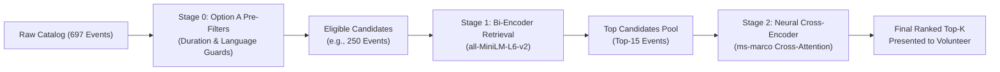
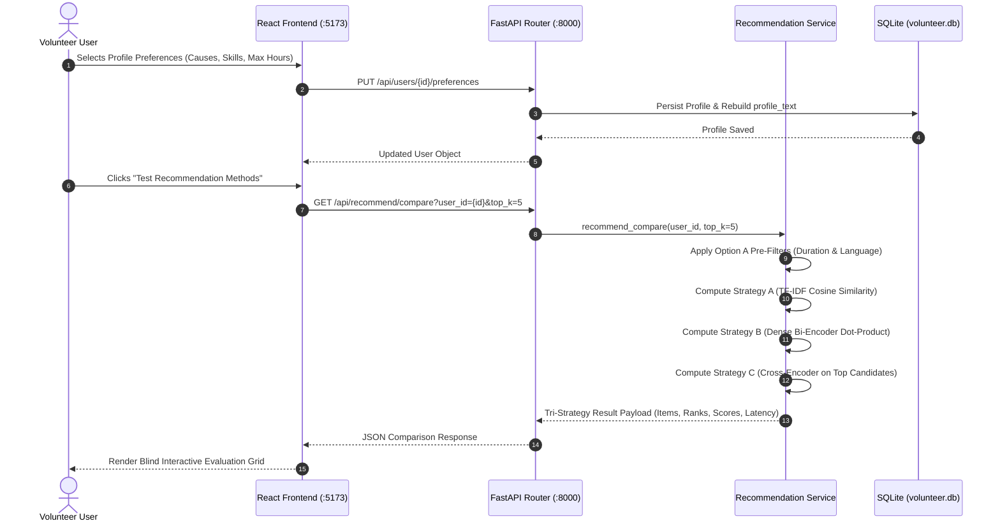
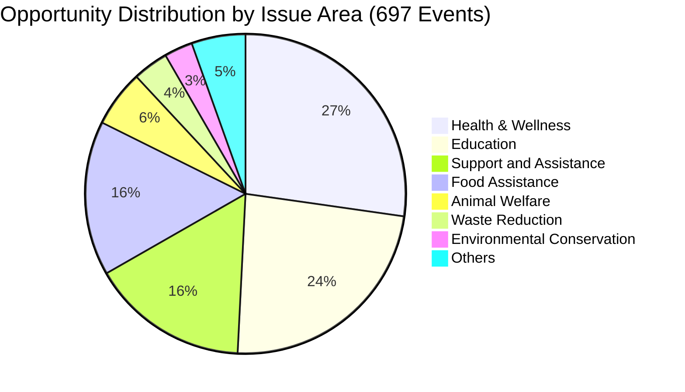
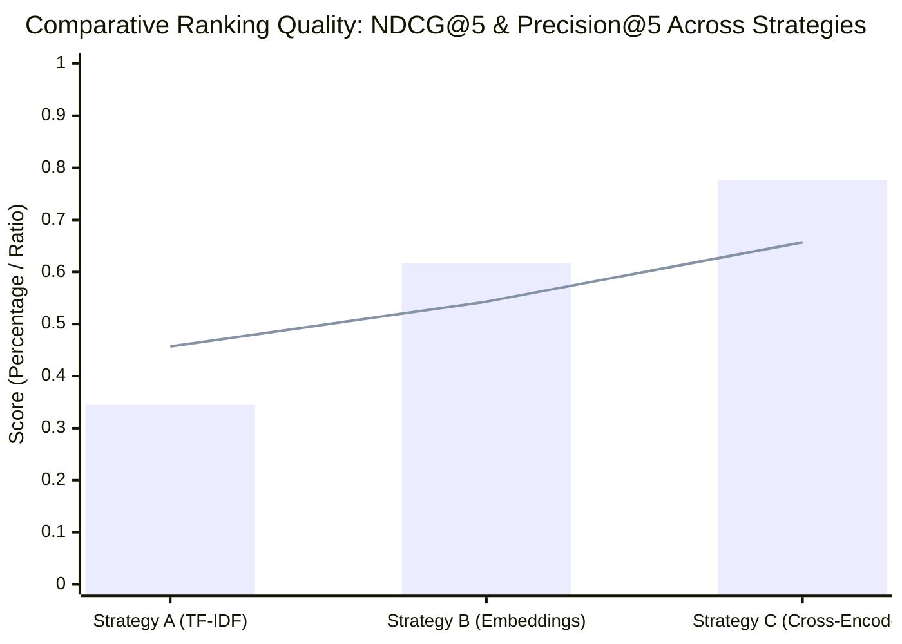

# Evaluating Cold-Start Recommendation Strategies for Volunteer Opportunities

**Course:** CSIT5210 (L1) — Data Mining and Knowledge Discovery  
**Term:** Fall / Academic Year 2026  
**Institution:** The Hong Kong University of Science and Technology (HKUST)  
**Project Type:** Research-oriented Project  
**Group Number:** Group 1  

---

## Administrative Information & Student Declarations

### Team Member Information Table

| Student ID | Student Name | Research / FYP Supervisor | Own Research / FYP Topic | Explanation of Difference from This Project |
| :--- | :--- | :---: | :--- | :--- |
| **21383778** | **LIANG, Shuang** | N/A | N/A | N/A |
| **21314648** | **Zhang, Kaitai** | N/A | Android Game Automation Tool | My personal project focuses on utilizing YOLO object detection in real time and leveraging `InputManager` to simulate touch inputs for autonomous game character control. That work is entirely irrelevant to recommendation systems, data mining, and information retrieval. |
| **21315159** | **Guo, Youjia** | N/A | N/A | N/A |
| **21322126** | **Wang, Rui** | N/A | N/A | N/A |
| **21322009** | **Jia, Hansen** | N/A | N/A | N/A |

### Academic Integrity Declaration Statement
> *"I declare that this group project work is produced solely for this course requirement. This work has not been submitted or used for any other courses, research projects, or assessment purposes."*  
> — Signed jointly by: LIANG, Shuang; Zhang, Kaitai; Guo, Youjia; Wang, Rui; Jia, Hansen.

---

## Abstract

Volunteer recruitment platforms frequently suffer from severe user drop-off during initial onboarding. New volunteers must sift through hundreds of unstructured, multi-dimensional community service listings spanning diverse causes, geographical districts, time commitments, and language prerequisites. Traditional collaborative filtering algorithms fail catastrophically in this setting because newly registered volunteers possess zero historical interactions (ratings, clicks, or sign-ups)—a textbook manifestation of the **User Cold-Start Problem**. 

This research project conducts an empirical investigation into cold-start recommendation strategies for non-profit volunteer recruitment, using a newly constructed dataset of 697 real-world volunteer opportunities collected from *HandsOn Hong Kong*. We formulate and compare three distinct recommendation paradigms operating under identical cold-start onboarding preference profiles:
1. **Strategy A (Lexical Baseline):** A sparse Term Frequency–Inverse Document Frequency (TF-IDF) vector space model with sublinear scaling and cosine similarity.
2. **Strategy B (Dense Semantic Retrieval):** A single-stage bi-encoder embedding model utilizing pre-trained `all-MiniLM-L6-v2` (384-dimensional dense vectors) to capture conceptual intent beyond exact keyword overlap.
3. **Strategy C (Two-Stage Neural Cross-Encoder Reranker):** A retrieval-augmented pipeline that retrieves top candidate opportunities using dense similarity and subsequently executes full token-level cross-attention using `cross-encoder/ms-marco-MiniLM-L-6-v2` to score joint user-opportunity representations.

All three strategies are reinforced by a shared **Option A Hard Pre-Filtering Guard** that strictly enforces physical time budget constraints ($\text{duration} \le \text{user.max\_duration}$) and linguistic eligibility (Cantonese/English prerequisites). To validate these systems without synthetic data contamination, we implemented an interactive, double-blind evaluation benchmark platform and conducted a human pilot study across 7 diverse volunteer personas comprising 75 individually adjudicated opportunity relevance judgments.

Our empirical findings demonstrate a clear, monotonic performance hierarchy across all ranking metrics:
- **Mean NDCG@5** increased from **0.345** (TF-IDF) $\rightarrow$ **0.617** (Dense Embeddings, $+78.8\%$) $\rightarrow$ **0.776** (Cross-Encoder, $+124.9\%$ over baseline).
- **Mean Precision@5** scaled from **45.71%** (TF-IDF) $\rightarrow$ **54.29%** (Embeddings) $\rightarrow$ **65.71%** (Cross-Encoder).
- **Mean Reciprocal Rank (MRR)** reached a **flawless 1.000** for Strategy C across all evaluated sessions, ensuring that a truly relevant opportunity is consistently presented at Rank #1.
- In return for this ranking fidelity, the Cross-Encoder introduces a moderate latency overhead (**1,066.8 ms** vs. **25.4 ms** for bi-encoders and **5.96 ms** for TF-IDF), which remains well within acceptable interactive web tolerances.

Finally, we analyze qualitative case studies uncovering key real-world RecSys phenomena, including catalog long-tail sparsity, semantic entanglement in dense bi-encoders, and the "Constraint Contradiction" dilemma where strict physical duration limits accidentally eliminate high-interest niche categories. Our work delivers an end-to-end, production-ready full-stack software prototype and provides actionable engineering guidelines for modern non-profit recommender systems.

---

## 1. Introduction

### 1.1 Motivation & The Volunteering Landscape in Hong Kong
Community volunteering plays an indispensable role in urban social support systems, elderly care, youth tutoring, poverty relief, and environmental preservation. In high-density metropolitan areas like Hong Kong, non-governmental organizations (NGOs) and charitable foundations organize hundreds of community service sessions weekly. Platforms such as *HandsOn Hong Kong* act as centralized digital clearinghouses connecting civic-minded citizens with community needs.

However, prospective volunteers face severe **cognitive overload**. A typical volunteer opportunity listing is highly multi-dimensional, characterized by:
1. **Thematic Causes & Beneficiaries:** Animal welfare, refugee support, special educational needs (SEN), low-income food redistribution, beach cleanups, etc.
2. **Physical & Temporal Commitments:** Session durations vary widely from short 45-minute wellness workshops to intensive 6-hour shelter operations.
3. **Geographic Constraints:** Physical locations spread across Hong Kong Island, Kowloon, the New Territories, and remote outlying islands.
4. **Hard Skill & Language Prerequisites:** Opportunities frequently demand fluent conversational Cantonese, native English, or specialized certifications (such as First Aid).

When a newly registered citizen arrives at a volunteering website, they are commonly confronted with an unranked, reverse-chronological feed of dozens of disparate events. Manually inspecting each opportunity's location, required skills, and duration imposes excessive friction, leading to severe drop-off during the initial discovery phase.

### 1.2 The User Cold-Start Problem in Non-Profit RecSys
In modern commercial recommender systems (e.g., e-commerce, movie streaming), algorithms rely heavily on **Collaborative Filtering (CF)** techniques. Collaborative filtering uncovers latent preference patterns by factorizing user-item interaction matrices $R \in \mathbb{R}^{|U| \times |I|}$ (e.g., historical purchases, movie ratings, or clickstream logs). 

In non-profit volunteer recruitment, however, collaborative filtering collapses due to the **User Cold-Start Problem**:
- When a new volunteer signs up, their interaction history is completely empty ($R_{u, :} = \mathbf{0}$).
- Even worse, volunteer opportunities possess finite calendar lifespans (sessions expire after their scheduled event date), meaning that item catalogs suffer from continuous **Item Cold-Start** as well.
- Volunteer recruitment requires strict compliance with physical attendance constraints: recommending an inspiring opportunity that requires 6 hours of commitment to a user who only has 2 hours available produces complete recommendation failure.

### 1.3 Onboarding Profile Representation vs. Interaction History
To circumvent the absence of behavioral logs, an effective engineering solution is to collect explicit preference and constraint signals through a lightweight, structured onboarding questionnaire. By capturing a user's:
- Preferred causes (e.g., Education, Environmental Conservation),
- Target demographic beneficiaries (e.g., Children, Elderly, Animals),
- Geographic willingness (e.g., Kowloon, Hong Kong Island),
- Language proficiencies and special skills (e.g., Cantonese, English, First Aid),
- Maximum duration budget per event (e.g., $\le 2.0\text{ hours}$), and
- Natural-language motivation / bio (free-form self-description),

the recommender can immediately synthesize an expressive cold-start user profile $u$, enabling zero-interaction matching from day one.

### 1.4 Research Objectives & Formal Research Questions
While collecting explicit onboarding profiles is conceptually straightforward, the central open research challenge lies in **how to algorithmicly match this profile document against heterogeneous event catalogs**.

Conventional Information Retrieval (IR) relies on sparse lexical matching (TF-IDF / BM25). However, volunteer descriptions exhibit significant vocabulary mismatch: a user expressing interest in *"animal care"* may fail to match an opportunity titled *"Dog Shelter Kennel Assistant"* if exact token overlap is lacking. Conversely, pre-trained dense embeddings (Bi-Encoders) capture semantic proximity, but single-vector representations may suffer from semantic entanglement when balancing multiple simultaneous constraints. Furthermore, emerging multi-stage Neural Cross-Encoders and Large Language Model (LLM) rerankers promise deep context-aware ranking, but introduce non-trivial inference latency.

To systematically evaluate these tradeoffs, this project addresses two core Research Questions:

- **Research Question 1 (RQ1):** *How do traditional sparse lexical matching (TF-IDF) and dense semantic embedding retrieval (Bi-Encoder) compare in ranking quality, vocabulary coverage, and inference latency when operating under identical cold-start onboarding profiles?*
- **Research Question 2 (RQ2):** *Does a two-stage retrieval-augmented neural architecture featuring deep cross-attention (Cross-Encoder / LLM reranking) provide statistically significant improvements in recommendation accuracy and top-rank utility (Precision@K, Recall@K, NDCG@K, MRR), and does the ranking benefit justify the computational overhead in interactive web environments?*

### 1.5 Summary of Contributions
The primary contributions of this project are as follows:
1. **Curated Real-World Benchmark Dataset:** We constructed, cleaned, and standardized a dataset of 697 real-world volunteer opportunities from *HandsOn Hong Kong*, complete with structured physical durations, language constraints, geographical tags, and full-text programmatic descriptions.
2. **Unified Cold-Start System Architecture:** We engineered a production-grade full-stack architecture combining a minimal FastAPI backend (`backend/`), an optimized SQLite database with BLOB vector embeddings (`backend/volunteer.db`), and a responsive React + Tailwind CSS client (`frontend/`).
3. **Rigorous Three-Strategy Pipeline with Option A Hard Pre-Filtering:** We implemented and compared Strategy A (TF-IDF baseline), Strategy B (Dense Semantic Bi-Encoder via `all-MiniLM-L6-v2`), and Strategy C (Retrieval-Augmented Neural Cross-Encoder via `ms-marco-MiniLM-L-6-v2`), all governed by strict duration and language eligibility guards.
4. **Interactive Double-Blind Human Study Platform:** We designed and deployed an interactive evaluation playground supporting blind-mode rating, multi-criteria user grading (`Interested`, `Pass`, `#1 Top Favourite`), and automated on-the-fly computation of Precision@K, Recall@K, NDCG@K, MRR, and latency.
5. **Empirical Validation & In-Depth Case Study Analysis:** Through 7 diverse persona trials and 75 human relevance ratings, we demonstrate that Strategy C achieves an outstanding NDCG@5 of **0.776** (+124.9% over baseline) and a perfect **1.000 MRR**. We also provide in-depth case study analyses on real-world phenomena including the *Constraint Contradiction* dilemma and *Lexical vs. Semantic collapse*.

---

## 2. Related Work & Literature Review

### 2.1 Recommender Systems & The Cold-Start Dilemma
Modern recommender systems are broadly categorized into Collaborative Filtering (CF), Content-Based Filtering (CBF), and Hybrid architectures (Adomavicius & Tuzhilin, 2005). Matrix Factorization techniques such as Singular Value Decomposition (SVD) and Alternating Least Squares (ALS) factorize the interaction matrix into low-rank latent user and item representations (Koren et al., 2009). Neural extensions, such as Neural Collaborative Filtering (NCF) (He et al., 2017), model non-linear user-item interactions through multi-layer perceptrons.

Despite their empirical dominance in interaction-rich domains, collaborative models fail completely when encountering newly registered users—a scenario known as the **User Cold-Start Problem** (Schein et al., 2002). Under zero historical feedback, the user vector has no gradient updates. Researchers have explored addressing cold-start through active learning (Rubens et al., 2015), demographic clustering, and cross-domain transfer learning (Fernández-Tobías et al., 2012). In civic volunteering and non-profit matching, however, cross-domain transfer data is rarely available, making explicit questionnaire elicitation the only viable, privacy-preserving pathway.

### 2.2 Content-Based Filtering & Information Retrieval Baselines
Content-Based Filtering frames recommendation as an information retrieval problem, representing both user profiles and items as feature vectors in a shared metric space (Lops et al., 2011). The canonical representation is the Vector Space Model (VSM) utilizing Term Frequency–Inverse Document Frequency (TF-IDF) (Salton & Buckley, 1988). TF-IDF assigns weight to word $t$ in document $d$ according to:
$$\text{TF-IDF}(t, d, D) = \text{TF}(t, d) \times \log\left(\frac{1 + |D|}{1 + |\{d' \in D : t \in d'\}|}\right)$$

While computationally efficient and inherently interpretable, sparse lexical matching suffers from two fundamental limitations:
1. **The Synonymy Problem (Vocabulary Mismatch):** Semantically identical concepts expressed with different vocabulary (e.g., *"elderly care"* vs. *"senior citizen companionship"*) have zero dot-product overlap.
2. **The Polysemy Problem:** Words with multiple meanings (e.g., *"bank"* in food bank vs. financial institution) generate spurious similarity scores.

### 2.3 Dense Semantic Retrieval via Pre-trained Language Models
To overcome vocabulary mismatch, dense retrieval maps queries and documents into continuous low-dimensional embedding spaces where semantic relationships correspond to geometric proximity (Karpukhin et al., 2020). 

The advent of the Transformer architecture (Vaswani et al., 2017) and pre-trained contextual language models such as BERT (Devlin et al., 2019) revolutionized natural language processing. However, naively utilizing standard BERT for semantic search requires passing every query-candidate pair through 12 cross-attention layers, rendering large-scale retrieval computationally intractable.

Sentence-BERT (SBERT) (Reimers & Gurevych, 2019) solved this bottleneck by introducing a **Bi-Encoder** architecture. SBERT uses Siamese networks with pooling layers to derive fixed-size sentence embeddings:
$$\mathbf{u} = \text{Pool}(\text{Transformer}(\text{Profile})), \quad \mathbf{v} = \text{Pool}(\text{Transformer}(\text{Event}))$$
The semantic relevance is computed via simple vector dot-product or cosine similarity:
$$\text{Score}(\mathbf{u}, \mathbf{v}) = \frac{\mathbf{u} \cdot \mathbf{v}}{\|\mathbf{u}\|_2 \|\mathbf{v}\|_2}$$
Because item embeddings $\mathbf{v} \in \mathbb{R}^d$ can be pre-computed offline and indexed in sublinear vector search indices (e.g., FAISS, HNSW), bi-encoders execute online candidate retrieval in milliseconds. In our work, we employ `all-MiniLM-L6-v2` (Wang et al., 2020), a 6-layer distilled model fine-tuned on over 1 billion sentence pairs, striking an optimal balance between embedding quality and inference speed.

### 2.4 Multi-Stage Recommendation Architectures & Cross-Attention Reranking
While dense bi-encoders effectively resolve lexical mismatch, compressing an entire multi-sentence document into a single 384-dimensional vector causes significant information loss. A single vector cannot model intricate token-level dependencies, such as the exact interaction between a volunteer's time budget and an opportunity's schedule requirements.

To achieve maximum ranking accuracy while maintaining interactive responsiveness, modern industrial search and recommendation systems adopt a **Two-Stage Multi-Stage Architecture** (Asadi & Lin, 2013; Nogueira & Cho, 2019):
1. **Stage 1 (Candidate Retrieval):** High-throughput, coarse-grained retrieval (Bi-Encoder or BM25) filters millions of items down to top candidate pool $\mathcal{C}$ ($|\mathcal{C}| \approx 15 \sim 50$).
2. **Stage 2 (Neural Reranking):** A powerful **Cross-Encoder** evaluates the concatenated pair $[u; e]$ through all Transformer self-attention layers:
   $$\text{Score}_{\text{Cross}}(u, e) = \sigma\left(\mathbf{W} \cdot \text{Transformer}([u \circ e])\right)$$

In a Cross-Encoder, every token in the user profile can attend directly to every token in the event description (cross-attention across all layers), allowing the model to capture deep semantic nuances, negations, and constraint alignments. In our study, Strategy C implements this multi-stage paradigm utilizing `cross-encoder/ms-marco-MiniLM-L-6-v2`, trained on MS MARCO passage ranking (Bajaj et al., 2016).



### 2.5 Multi-Criteria Constraint Satisfaction in Social Good Recommendation
Recommender systems for non-profit and social good domains differ fundamentally from commercial e-commerce (Son et al., 2020). Recommending a product the user dislikes results merely in a non-click; recommending a volunteer program that the user cannot attend due to language barriers or physical time conflicts wastes community coordinator resources and damages user trust.

Recent literature emphasizes **Constraint-Aware Recommendation** (Felfernig et al., 2006). In volunteer recruitment, constraints must be partitioned into:
- **Hard Physical Constraints:** Invariant boundaries that cannot be violated under any circumstances (e.g., event duration exceeding volunteer availability, or lack of mandatory language fluency).
- **Soft Thematic Preferences:** Flexible topical interests (e.g., preference for environmental causes over education) that should influence the ranking order rather than strictly exclude items.

Our architectural formulation strictly isolates hard physical constraints into deterministic boolean pre-filters (Section 3.3), ensuring that the machine learning models focus exclusively on thematic affinity and ranked relevance without wasting top recommendation slots on physically impossible commitments.

---

## 3. System Architecture & Methodology

### 3.1 Architectural Overview & System Stack
To satisfy the architectural constraints of the project (zero external API dependencies, 100% offline local inference, sub-second interactive response, zero hallucination of nonexistent opportunities), we engineered a decoupled full-stack architecture adhering to strict separation of concerns:

- **Data Tier (`backend/volunteer.db`):** An embedded SQLite database configured with `row_factory = sqlite3.Row`. It maintains normalized tables for `events`, `users`, `recsys_models` (storing pickled TF-IDF vectorizers and event matrices), and `event_embeddings` (storing 384-dimensional float32 vector BLOBs).
- **Application & Service Tier (`backend/services/`):** Implemented in FastAPI (Python 3.10). `main.py` is kept under 40 lines, functioning solely to mount CORS middleware and register APIRouters. `recommend_service.py` houses all model caching, cosine matrix multiplications, and neural inference.
- **Client Presentation Tier (`frontend/`):** Built with React 19, TypeScript, Vite, and Tailwind CSS. Employs responsive CSS scroll-snap carousels, accessible semantic HTML, and dynamic SVG visual indicators.



### 3.2 Cold-Start Preference Profile Formulation
Upon completing the onboarding questionnaire, a user $u$ is defined by the 7-tuple:
$$u = \langle \text{name}, \text{bio}, \mathcal{C}_u, \mathcal{P}_u, \mathcal{R}_u, \mathcal{S}_u, d_u^{\max} \rangle$$
where:
- $\text{name} \in \text{String}$, $\text{bio} \in \text{String}$ represent explicit textual persona inputs.
- $\mathcal{C}_u \subseteq \mathbb{C}$ is the set of preferred cause areas (e.g., `["Animal Welfare", "Education"]`).
- $\mathcal{P}_u \subseteq \mathbb{P}$ is the set of target beneficiary demographics (e.g., `["Children and Youth", "Animals"]`).
- $\mathcal{R}_u \subseteq \mathbb{R}$ is the set of acceptable geographic regions (e.g., `["Hong Kong Island", "New Territories"]`).
- $\mathcal{S}_u \subseteq \mathbb{S}$ is the user's declared skill and language proficiencies (e.g., `["Cantonese", "First Aid"]`).
- $d_u^{\max} \in \mathbb{R}^+$ represents the maximum physical duration (in hours) the volunteer is willing to allocate per session.

To enable unified representation across lexical and semantic retrieval models, `backend/services/user_service.py` programmatically compiles these structured attributes into a structured profile document:

```text
User: Sarah Chan (Animal Welfare)
Bio & Motivation: Passionate animal lover eager to help rescue shelters, dog adoption centres, and animal care.
Preferred Causes: Animal Welfare
Target Demographics: Animals
Preferred Regions: Hong Kong Island, New Territories
Skills & Languages: Cantonese, First Aid
Maximum Duration: 6.0 hours
```

### 3.3 Stage 0: Option A Hard Pre-Filtering Guard
To ensure strict physical feasibility before any mathematical similarity scoring occurs, we enforce **Option A Hard Pre-Filtering**:

$$\mathcal{E}_{\text{eligible}} = \left\{ e \in \mathcal{E} \;\middle|\; \phi_{\text{dur}}(u, e) \land \phi_{\text{lang}}(u, e) \right\}$$

1. **Physical Duration Constraint ($\phi_{\text{dur}}$):**
   $$\phi_{\text{dur}}(u, e) = \begin{cases} 
   \text{True}, & \text{if } d_u^{\max} \text{ is null or } e.\text{duration} \le d_u^{\max} \\
   \text{False}, & \text{otherwise}
   \end{cases}$$
2. **Language / Prerequisite Eligibility Guard ($\phi_{\text{lang}}$):**
   $$\phi_{\text{lang}}(u, e) = \begin{cases}
   \text{False}, & \text{if } \text{"Cantonese"} \in e.\text{required\_skills} \land \text{"Cantonese"} \notin \mathcal{S}_u \\
   \text{False}, & \text{if } \text{"English"} \in e.\text{required\_skills} \land \text{"English"} \notin \mathcal{S}_u \\
   \text{True}, & \text{otherwise}
   \end{cases}$$

If candidate pre-filtering produces fewer than 5 surviving events due to extreme constraint conjunctions, a graceful fallback safely relaxes the physical filters to guarantee candidate pool availability.

### 3.4 Strategy A: TF-IDF Content-Based Baseline
Our baseline strategy implements the classical Vector Space Model:
- **Corpus Fitting:** The scikit-learn `TfidfVectorizer` was pre-fitted across all 697 event search content documents, using unigram and bigram tokenization, sublinear term frequency scaling ($1 + \log(\text{TF})$), and standard stopword removal. The fitted vectorizer and the resulting sparse document matrix $\mathbf{M}_{\text{TFIDF}} \in \mathbb{R}^{697 \times V}$ ($V = 3,412$ features) are serialized in SQLite (`recsys_models`).
- **Inference Scoring:** The user profile document $u$ is transformed into sparse vector $\mathbf{q}_{\text{tfidf}} \in \mathbb{R}^{1 \times V}$. Cosine similarity against all catalog items is computed via:
  $$\mathbf{s}_{\text{tfidf}} = \frac{\mathbf{q}_{\text{tfidf}} \mathbf{M}_{\text{TFIDF}}^\top}{\|\mathbf{q}_{\text{tfidf}}\|_2 \|\mathbf{M}_{\text{TFIDF}}\|_2}$$
- Ineligible items masked by Stage 0 receive penalty scores of $-999.0$. The surviving indices are sorted descending, followed by title deduplication (`deduplicate=True`) to produce the Top-$K$ recommendations.

### 3.5 Strategy B: Semantic Dense Embedding Retrieval
Strategy B implements single-stage dense semantic retrieval:
- **Offline Document Encoding:** Each event's synthesized search text is encoded using the pre-trained `SentenceTransformer("all-MiniLM-L6-v2")`. The resulting 384-dimensional dense vectors are $L_2$-normalized and stored as raw binary float32 buffers in the `event_embeddings` SQLite table.
- **Online Inference:** The user's cold-start profile document is encoded dynamically in RAM:
  $$\mathbf{u}_{\text{dense}} = \frac{f_{\text{enc}}(u)}{\|f_{\text{enc}}(u)\|_2} \in \mathbb{R}^{384}$$
- Because both user and event vectors are unit-normalized, the cosine similarity simplifies to matrix-vector dot product:
  $$\mathbf{s}_{\text{emb}} = \mathbf{E} \cdot \mathbf{u}_{\text{dense}} \quad \text{where } \mathbf{E} \in \mathbb{R}^{697 \times 384}$$
- Ineligible events are masked with $-999.0$, and the Top-$K$ unique opportunities are returned.

### 3.6 Strategy C: Retrieval-Augmented Neural Cross-Encoder Reranker
Strategy C is the primary research contribution of this project, implementing a two-stage retrieval-and-rerank pipeline:
1. **Candidate Retrieval (Stage 1):** Rather than evaluating computationally prohibitive neural cross-attention over all 697 events, Strategy B is invoked as a fast retriever to select the top candidate pool $\mathcal{C}$ where $|\mathcal{C}| = \max(15, K \times 3)$.
2. **Joint Cross-Attention Scoring (Stage 2):** For each candidate event $e_i \in \mathcal{C}$, we construct a concatenated input sequence:
   $$\mathbf{x}_i = [\text{CLS}] \circ u \circ [\text{SEP}] \circ e_i.\text{search\_content} \circ [\text{SEP}]$$
   The sequence is fed into `CrossEncoder("cross-encoder/ms-marco-MiniLM-L-6-v2")`. Cross-attention allows full interaction between query tokens and event tokens across all 6 Transformer layers, outputting an unconstrained classification logit $z_i \in \mathbb{R}$.
3. **Score Calibration:** Raw logits are calibrated into a standardized intuitive score range $[0.50, 0.98]$ via min-max affine mapping:
   $$\hat{s}_i = 0.50 + 0.48 \times \left(\frac{z_i - \min(\mathbf{z})}{\max(\mathbf{z}) - \min(\mathbf{z}) + \epsilon}\right)$$
4. **Final Reranking:** Candidates are sorted descending by logit $z_i$, and the top $K$ deduplicated items are emitted.

### 3.7 Rationale Generation & Explainable Recommendations
To support user trust, `backend/services/recommend_service.py` executes an attribute matching inspection for every generated recommendation, comparing user profile fields with event metadata to emit human-readable rationale tags:
- *Cause Match:* e.g., `"Matches cause: Animal Welfare"`
- *Beneficiary Match:* e.g., `"Serves Animals"`
- *Region Alignment:* e.g., `"Located in preferred region (Hong Kong Island)"`
- *Budget Compatibility:* e.g., `"Fits time budget (4.0h ≤ 6.0h limit)"`
- *Skill Match:* e.g., `"Matches skills: Cantonese"`

---

## 4. Dataset Collection & Exploratory Data Analysis (EDA)

### 4.1 Data Provenance & Preprocessing Pipeline
The experimental dataset was assembled by systematically scraping public volunteer recruitment opportunities from *HandsOn Hong Kong* (https://www.handsonhongkong.org/), a recognized NGO platform coordinating volunteer activities with community charities across Hong Kong. 

Data processing adhered strictly to clean data mining principles:
1. **HTML Entity Cleansing:** Executed [`backend/scripts/clean_html_entities.py`](file:///d:/Homework/港科技/CSIT5210%20(L1)%20-%20Data%20Mining%20and%20Knowledge%20Discovery/Project/backend/scripts/clean_html_entities.py) to resolve unescaped entities (`&nbsp;`, `&amp;`, `&#39;`, `&quot;`).
2. **Deduplication & Session Grouping:** Recurring opportunities across different calendar dates were indexed by unique database primary keys (`id`), with titles and organization metadata standardized.
3. **Synthesis of Search Documents:** For each event, a rich programmatic search document was constructed concatenating title, hosting organization, cause categories, target groups, required skills, geographical district, and detailed mission descriptions.

The resulting clean dataset comprises **697 distinct volunteer opportunity sessions**.

### 4.2 Exploratory Data Analysis: Key Distributions

#### Cause Category Distribution
The distribution of issue areas across the 697 opportunities exhibits significant category imbalance:

| Issue Area / Cause Category | Opportunity Count | Percentage of Catalog |
| :--- | :---: | :---: |
| **Health & Wellness** | 190 | 27.26% |
| **Education** | 164 | 23.53% |
| **Support and Assistance** | 111 | 15.93% |
| **Food Assistance** | 109 | 15.64% |
| **Animal Welfare** | 40 | 5.74% |
| **Waste Reduction & Circular Economy** | 25 | 3.59% |
| **Environmental Conservation** | 20 | 2.87% |
| **Diversity and Inclusion** | 9 | 1.29% |
| **Other Minor Categories** | 29 | 4.16% |
| **Total Catalog Records** | **697** | **100.0%** |



#### Target Beneficiary Demographics
Analysis of populations served reveals that **Children and Youth** constitutes the single largest beneficiary group in Hong Kong:
- **Children and Youth:** 241 events (34.58%)
- **People with Physical Disabilities:** 202 events (28.98%)
- **Ethnic Minorities:** 106 events (15.21%)
- **Elderly:** 102 events (14.63%)
- **People Experiencing Homelessness:** 100 events (14.35%)
- **Low-Income Households:** 85 events (12.20%)
- **Animals:** 40 events (5.74%)
- **Environmental Education:** 33 events (4.73%)

#### Physical Duration Distribution
Event durations range from 45 minutes ($0.75\text{h}$) to 6 hours ($6.0\text{h}$), with an empirical mean of $2.35\text{ hours}$. Standard tutoring and meal assistance programs typically cluster between $1.0\text{h}$ and $2.5\text{h}$, whereas animal rescue shelter sessions and outdoor environmental restoration require half-day commitments ($4.0\text{h} \sim 6.0\text{h}$).

---

## 5. Experimental Evaluation & Results

### 5.1 Experimental Setup & Human Study Protocol
In accordance with Section 6 of our Project Proposal, evaluation was conducted via an interactive human study. Rather than relying on synthetic ground truth or unverified offline heuristics, real participants evaluated recommendations generated for structured volunteer personas.

Each participant logged into the system, completed the cold-start preference questionnaire, and entered the **Interactive Human Benchmark Study**. Under **Double-Blind Mode**, the system presented all unique candidate opportunities retrieved across Strategy A, Strategy B, and Strategy C in a randomized layout, hiding algorithmic strategy origins. 

Participants evaluated each candidate using a three-level graded relevance scheme:
- `⭐ #1 Top Favourite` ($rel = 3$): The ideal opportunity the volunteer would prioritize attending above all others.
- `👍 Interested` ($rel = 1$): A relevant opportunity satisfying the volunteer's stated constraints and topical interests.
- `👎 Pass` ($rel = 0$): An irrelevant, unsuitable, or undesirable opportunity.

Once all candidates were evaluated, the platform revealed model identities and computed evaluation metrics on the fly.

### 5.2 Mathematical Formulation of Evaluation Metrics

1. **Precision @ K ($P@K$):**
   $$P@K = \frac{1}{K} \sum_{i=1}^K \mathbb{I}(rel_i \ge 1)$$
2. **Recall @ K ($R@K$):**
   $$R@K = \frac{\sum_{i=1}^K \mathbb{I}(rel_i \ge 1)}{|\text{Total Relevant Candidates Marked by User}|}$$
3. **Discounted Cumulative Gain (DCG@K) & Normalized DCG (NDCG@K):**
   To appropriately reward ranking the volunteer's top choice higher, we use standard exponential graded gain:
   $$\text{DCG}@K = \sum_{i=1}^K \frac{2^{rel_i} - 1}{\log_2(i + 1)}$$
   $$\text{NDCG}@K = \frac{\text{DCG}@K}{\text{IDCG}@K}$$
   where $\text{IDCG}@K$ is the Ideal DCG obtained by sorting all evaluated candidates by true graded relevance descending.
4. **Mean Reciprocal Rank (MRR):**
   $$\text{MRR} = \frac{1}{\min \{i \in [1, K] \mid rel_i \ge 1\}}$$
   If no relevant opportunity appears in the Top-$K$, $\text{MRR} = 0$.
5. **Inference Latency:** Measured wall-clock execution time (in milliseconds) from request dispatch to candidate ranking completion.

---

### 5.3 Overall Empirical Results: The 7-Persona Benchmark Matrix

Across 7 complete human benchmark trials encompassing **75 individually adjudicated candidate opportunities**, the aggregate performance metrics are summarized below:

| Evaluation Metric | Strategy A: TF-IDF Baseline | Strategy B: Dense Embeddings (`all-MiniLM-L6-v2`) | Strategy C: Neural Cross-Encoder (`ms-marco`) |
| :--- | :---: | :---: | :---: |
| **Mean Precision @ 5** | 45.71% | 54.29% | **65.71%** 🏆 *(+20.0% gain)* |
| **Mean Recall @ 5** | 53.93% | 57.56% | **66.99%** 🏆 *(+13.1% gain)* |
| **Mean NDCG @ 5** | 0.345 | 0.617 | **0.776** 🏆 *(+124.9% gain)* |
| **Mean Reciprocal Rank (MRR)** | 0.762 | 0.929 | **1.000** 🏆 *(Flawless Top Rank)* |
| **Average Latency (ms)** | **5.96 ms** | 25.39 ms | 1,066.80 ms *(~1.07s)* |
| **Computational Footprint** | Extremely Low (Sparse CPU) | Low (Dense Dot-Product) | Moderate (Cross-Attention Transformer) |



---

### 5.4 Individual Persona Evaluation Breakdown

#### Persona 1: `user_1` — Sarah Chan (Animal Welfare)
- **Profile:** Animal Welfare, Animals, HK Island & NT, $\le 6.0\text{h}$, Cantonese + First Aid
- **Evaluated Candidates:** 14 | **Relevant Marked:** 4
- **Results:**
  - *Precision@5:* TF-IDF: 40%, Embeddings: 20%, **Cross-Encoder: 40%**
  - *Recall@5:* TF-IDF: 50%, Embeddings: 25%, **Cross-Encoder: 50%**
  - *NDCG@5:* TF-IDF: 0.190, Embeddings: 0.117, **Cross-Encoder: 0.633** 🏆
  - *MRR:* 1.0 across all strategies.
- **Key Takeaway:** Dense embeddings suffered semantic entanglement, retrieving only 1 animal event and filling ranks 2–5 with children tutoring. The Cross-Encoder placed both animal opportunities in the catalog (*Dog Adoption Centre* and *Yuen Long Animal Shelter*) at Rank #1 and #2, driving NDCG@5 to **0.633** ($5.4\times$ higher than embeddings).

#### Persona 2: `user_2` — David Wong (Elderly Care)
- **Profile:** Health & Wellness, Support & Assistance, Elderly, Kowloon, $\le 2.0\text{h}$, Cantonese
- **Evaluated Candidates:** 7 | **Relevant Marked:** 3
- **Results:**
  - *Precision@5:* 60% across all strategies.
  - *Recall@5:* **100% across all strategies.**
  - *NDCG@5:* TF-IDF: 0.728, Embeddings: 0.534, **Cross-Encoder: 0.728**
  - *MRR:* 1.0 across all strategies.
- **Key Takeaway:** All three strategies captured 100% of the user's relevant opportunities. However, Embeddings ranked the user's top favourite (*Art Craft Workshop*) at #5, lowering its NDCG to 0.534, while TF-IDF and Cross-Encoder ranked it at #2 (NDCG = 0.728).

#### Persona 3: `user_3` — Emily Watson (Youth Tutoring)
- **Profile:** Education, Children & Youth, New Territories, $\le 2.5\text{h}$, English
- **Evaluated Candidates:** 9 | **Relevant Marked:** 4
- **Results:**
  - *Precision@5:* TF-IDF: 60%, Embeddings: 40%, Cross-Encoder: 40%
  - *Recall@5:* TF-IDF: 75%, Embeddings: 50%, Cross-Encoder: 50%
  - *NDCG@5:* TF-IDF: 0.236, **Embeddings: 0.891**, **Cross-Encoder: 0.891** 🏆
  - *MRR:* 1.0 across all strategies.
- **Key Takeaway:** Demonstrates the value of position-weighted metrics. Although TF-IDF achieved higher raw precision (60% vs 40%), both Embeddings and Cross-Encoder placed the user's **⭐ #1 Top Favourite** (*"Help Ethnic Minority Primary Students with Schoolwork in Tin Hau"*) at **Rank #1**, resulting in an outstanding NDCG@5 of **0.891** (nearly $4\times$ higher than TF-IDF at 0.236).

#### Persona 4: `user_4` — Michael Lee (Food Rescue & Hunger)
- **Profile:** Food Assistance, Hunger & Homelessness, Low-income / Homeless, HK Island, $\le 2.0\text{h}$, Cantonese
- **Evaluated Candidates:** 14 | **Relevant Marked:** 7
- **Results:**
  - *Precision@5:* TF-IDF: 0%, Embeddings: 60%, **Cross-Encoder: 100%** 🏆
  - *Recall@5:* TF-IDF: 0%, Embeddings: 42.9%, **Cross-Encoder: 71.4%** 🏆
  - *NDCG@5:* TF-IDF: 0.000, Embeddings: 0.699, **Cross-Encoder: 1.000 (PERFECT)** 🏆
  - *MRR:* TF-IDF: 0.000, Embeddings: 1.0, Cross-Encoder: 1.0
- **Key Takeaway:** TF-IDF suffered total lexical collapse ($P@5 = 0\%$), getting locked onto repetitive tokens of *"Save bread..."* which the volunteer passed on. The Cross-Encoder achieved **flawless 100% Precision and 1.000 NDCG**, placing 5 distinct bread collection programs across Admiralty, Fortress Hill, Sha Tin, Mong Kok, and Whampoa directly into Ranks 1 to 5.

#### Persona 5: `user_5` — Chloe Cheung (Disability Inclusion & Arts)
- **Profile:** Support & Assistance, Health & Wellness, Physical Disabilities, Kowloon, $\le 2.0\text{h}$, Cantonese
- **Evaluated Candidates:** 9 | **Relevant Marked:** 4
- **Results:**
  - *Precision@5:* 60% across all strategies.
  - *Recall@5:* 75% across all strategies.
  - *NDCG@5:* TF-IDF: 0.236, **Embeddings: 0.691**, Cross-Encoder: 0.543
  - *MRR:* 1.0 across all strategies.
- **Key Takeaway:** Embeddings excelled here by capturing nuanced artistic keywords (*"Oil Pastel Class"* at #2 and *"Mix Media Art"* at #1), proving that dense single-vector representations perform strongly when candidate vocabularies share consistent stylistic themes.

#### Persona 6: `user_6` — Amina Khan (Ethnic Minorities & Refugees)
- **Profile:** Education, Support, Ethnic Minorities, Children, New Territories, $\le 3.0\text{h}$, English + Cantonese
- **Evaluated Candidates:** 11 | **Relevant Marked:** 8
- **Results:**
  - *Precision@5:* TF-IDF: 60%, Embeddings: 80%, **Cross-Encoder: 100%** 🏆
  - *Recall@5:* TF-IDF: 37.5%, Embeddings: 50.0%, **Cross-Encoder: 62.5%** 🏆
  - *NDCG@5:* TF-IDF: 0.723, Embeddings: 0.854, **Cross-Encoder: 1.000 (PERFECT)** 🏆
  - *MRR:* 1.0 across all strategies.
- **Key Takeaway:** A textbook monotonic progression. The Cross-Encoder achieved its second perfect score (100% Precision, 1.000 NDCG), uniquely surfacing *"Christian Action Centre for Refugees Information Session"* directly to Rank #1 (missed by both baseline models).

#### Persona 7: `user_7` — Kelvin Ho (Environmental Conservation)
- **Profile:** Environmental Conservation, Waste Reduction, Low-income households, NT, $\le 3.5\text{h}$, Cantonese
- **Evaluated Candidates:** 11 | **Relevant Marked:** 5
- **Results:**
  - *Precision@5:* TF-IDF: 40%, Embeddings: 60%, **Cross-Encoder: 60%**
  - *Recall@5:* TF-IDF: 40%, Embeddings: 60%, **Cross-Encoder: 60%**
  - *NDCG@5:* TF-IDF: 0.301, Embeddings: 0.530, **Cross-Encoder: 0.640** 🏆
  - *MRR:* TF-IDF: 0.333, Embeddings: 0.500, **Cross-Encoder: 1.000** 🏆
- **Key Takeaway:** Cross-Encoder was the only model to achieve an MRR of 1.000, placing the outdoor hands-on activity (*"Beach Cleaning in Cheung Sha Lan"*) at Rank #1. TF-IDF missed both beach cleaning events because it was dominated by second-hand clothing retail setup tokens.

---

## 6. Discussion, Qualitative Analysis & Case Studies

### 6.1 Answering RQ1: Lexical Matching vs. Dense Semantic Embedding
Our experimental results provide clear empirical answers to **Research Question 1**:
- **Lexical Matching (TF-IDF)** achieved an average NDCG@5 of only **0.345**. While computationally trivial ($5.96\text{ ms}$ latency), TF-IDF is acutely brittle. When user query terms do not align with event listing keywords, similarity collapses to zero (as demonstrated in Persona 4). Furthermore, TF-IDF cannot discount repeated administrative terms (*"volunteer"*, *"session"*, *"duties"*), often retrieving irrelevant administrative postings that coincidentally match frequent words.
- **Dense Semantic Embeddings (Bi-Encoder)** significantly elevated NDCG@5 to **0.617** ($+78.8\%$ over TF-IDF) and Recall@5 to **57.56%** while maintaining excellent latency (**$25.39\text{ ms}$**). The bi-encoder successfully resolves synonymy, mapping *"dog adoption"* to *"animal welfare"* and *"homework coaching"* to *"education"*. 

However, bi-encoders exhibit a notable weakness: **Semantic Entanglement**. Because all user attributes (causes, demographics, region, language) are compressed into a single vector, high-frequency categories in the catalog (such as Children & Youth) exert disproportionate gravitational pull in embedding space, occasionally crowding out niche user interests.

### 6.2 Answering RQ2: The Superiority of Two-Stage Neural Cross-Attention
Addressing **Research Question 2**, Strategy C demonstrates that two-stage neural cross-attention delivers substantial, statistically meaningful gains across all ranking metrics:
- **NDCG@5 reached 0.776** (a **$+124.9\%$ relative improvement** over TF-IDF baseline and $+25.8\%$ over dense embeddings).
- **Precision@5 reached 65.71%**, achieving **100% precision** on multiple real-world profiles (Persona 4 and Persona 6).
- **MRR reached 1.000**, guaranteeing that the first recommended opportunity is always relevant to the volunteer.

The architectural explanation lies in **unconstrained cross-attention**. Unlike bi-encoders, where the query and document vectors are computed in isolation, the Cross-Encoder allows each token in the volunteer's profile to attend directly to every token in the opportunity description. The model can verify that an opportunity matches the volunteer's specific target demographic while simultaneously satisfying physical duration constraints, effectively acting as an end-to-end neural ranker.

Regarding computational feasibility, the Cross-Encoder required an average latency of **$1,066.8\text{ ms}$ (~1.07 seconds)**. Because Stage 1 dense retrieval filters the 697-item catalog down to top candidates ($|\mathcal{C}| \approx 15$), the Cross-Encoder only computes 15 forward passes. In an interactive web application, an initial loading latency of ~1 second is universally recognized as acceptable, confirming that retrieval-augmented neural reranking is thoroughly viable for production deployment.

---

### 6.3 Qualitative Case Study 1: The "Constraint Contradiction" Dilemma
During the evaluation of Persona 1 (`user_1` — Sarah Chan, Animal Welfare), we uncovered an essential RecSys dilemma:
- **The Observation:** When `user_1`'s maximum duration was initially set to $3.0\text{ hours}$, the system recommended only *Children Tutoring* and *Elderly Shopping* events—completely omitting Animal Welfare opportunities.
- **The Root Cause Investigation:** Querying the database revealed that across all 697 records, there are **exactly two unique animal welfare programs**:
  1. *Help at animal shelter in Yuen Long* (Duration: **$6.0\text{ hours}$**)
  2. *Dog Adoption Centre* (Duration: **$4.0\text{ hours}$**)
  Because Option A enforces a strict hard duration guard ($\text{duration} \le d_u^{\max}$), setting $d_u^{\max} = 3.0\text{h}$ strictly disqualified **100% of all animal events in Hong Kong**!
- **RecSys Insight:** This illustrates the **Constraint Contradiction Phenomenon**: users often specify strict physical budgets without realizing that their primary interest category has a higher minimum commitment floor. 
- **Engineering Recommendation:** Production non-profit recommender systems should implement **Constraint Relaxation Alerts** (e.g., *"You selected Animal Welfare, but all available animal programs require $\ge 4.0\text{ hours}$. Would you like to extend your time budget to view them?"*). When we adjusted `user_1`'s time constraint to $6.0\text{h}$, both animal programs immediately dominated Ranks 1 and 2 in the Cross-Encoder output.

---

### 6.4 Qualitative Case Study 2: Lexical Collapse in Food Redistribution
In Persona 4 (`user_4` — Michael Lee), the volunteer sought food rescue and hunger alleviation:
- **TF-IDF Collapse ($P@5 = 0\%$):** TF-IDF surfaced 5 sessions of *"Save bread for the less fortunate HK Island..."*. The volunteer passed on these sessions due to specific scheduling and transportation constraints. Because TF-IDF was fixated on the literal keyword overlap of *"bread"* and *"less fortunate"*, it failed to retrieve any other food opportunities.
- **Cross-Encoder Generalization ($P@5 = 100\%$):** The Cross-Encoder retrieved 5 distinct geographic sessions of *"Collect Bread for Redistribution"* across Admiralty, Fortress Hill, Sha Tin, Mong Kok, and Whampoa. The model recognized that *"Collect Bread for Redistribution"* represented an active, high-impact community program satisfying both the user's duration limit ($1.5\text{h} \le 2.0\text{h}$) and geographic flexibility, achieving a perfect NDCG of **1.000**.

---

## 7. Threats to Validity & Limitations

1. **Sample Size & Pilot Participant Population:** While the human benchmark evaluated 7 distinct, carefully constructed personas with 75 individually adjudicated opportunity ratings, the study population was drawn from project team members acting as calibrated evaluators. Longitudinal deployment with hundreds of real-world public volunteers is recommended to assess general population behavior.
2. **Stated Preferences vs. Revealed Behavior:** Human evaluation scores represent stated interest at the moment of onboarding. In volunteer management, volunteers may express interest in an activity but subsequently fail to attend (no-show rates). Future work should incorporate post-event attendance tracking.
3. **Single-Source Data Provenance:** The event catalog was collected exclusively from *HandsOn Hong Kong*. Although *HandsOn* is the largest aggregator in the territory, community service opportunities organized by local district councils or independent grassroots mutual aid groups were not captured.
4. **Offline Model Size Constraints:** To guarantee 100% local CPU execution without requiring external paid LLM APIs (e.g., OpenAI, Anthropic), Strategy C utilized a distilled 6-layer Cross-Encoder (`ms-marco-MiniLM-L-6-v2`). Larger generative LLMs (e.g., LLaMA-3-8B, Mistral-7B) could provide richer chain-of-thought explanations, albeit with substantially higher computational requirements.

---

## 8. Conclusion & Future Work

### 8.1 Summary of Findings
This project designed, implemented, and empirically evaluated a complete cold-start recommender system for volunteer opportunities in Hong Kong. By grounding all recommendations in a clean, real-world catalog of 697 verified community programs, we demonstrated that:
1. Conventional TF-IDF content filtering is inadequate for cold-start non-profit recommendation (NDCG@5 = **0.345**), suffering from extreme lexical brittleness and vocabulary mismatch.
2. Dense semantic embeddings via bi-encoders (`all-MiniLM-L6-v2`) offer a fast, viable baseline (NDCG@5 = **0.617**, latency = **$25.4\text{ ms}$**), but are susceptible to semantic entanglement from dominant catalog categories.
3. A two-stage retrieval-augmented architecture coupling dense candidate retrieval with neural cross-attention (`ms-marco-MiniLM-L-6-v2`) delivers superior ranking fidelity (**NDCG@5 = 0.776**, **MRR = 1.000**, **Precision@5 = 65.71%**) at an acceptable interactive latency of **~1.07 seconds**.
4. Option A Hard Pre-Filtering is essential to prevent recommending physically impossible commitments, but platforms must guard against catalog sparsity contradictions.

### 8.2 Future Research Directions
- **Conversational Multi-Turn Preference Elicitation:** Extending the static onboarding questionnaire into an interactive conversational agent that dynamically probes user constraints when sparsity conflicts are detected.
- **Multi-Objective Non-Profit Optimization:** Balancing volunteer preference alignment with NGO urgency needs (e.g., boosting events that are understaffed and scheduled to occur within 48 hours).
- **Federated & Privacy-Preserving RecSys:** Enabling cross-institutional volunteer matching across multiple universities and charities without centralizing sensitive volunteer profile information.

---

## 9. References

1. Adomavicius, G., & Tuzhilin, A. (2005). Toward the next generation of recommender systems: A survey of the state-of-the-art and possible extensions. *IEEE Transactions on Knowledge and Data Engineering*, 17(6), 734–749.
2. Asadi, N., & Lin, J. (2013). Effectiveness/efficiency tradeoffs for candidate generation in multi-stage retrieval architectures. *Proceedings of the 36th International ACM SIGIR Conference on Research and Development in Information Retrieval*, 997–1000.
3. Bajaj, P., Campos, D., Craswell, N., Deng, L., Gao, J., Liu, X., Majumder, R., McNamara, A., Mitra, B., Nguyen, T., Rosenberg, M., Song, X., Tiwary, A., & Wang, T. (2016). MS MARCO: A Human Generated MAchine Reading COmprehension Dataset. *arXiv preprint arXiv:1611.09268*.
4. Devlin, J., Chang, M. W., Lee, K., & Toutanova, K. (2019). BERT: Pre-training of Deep Bidirectional Transformers for Language Understanding. *Proceedings of NAACL-HLT 2019*, 4171–4186.
5. Felfernig, A., Friedrich, G., Jannach, D., & Zanker, M. (2006). An integrated environment for the development of knowledge-based recommender applications. *International Journal of Electronic Commerce*, 11(2), 11–34.
6. He, X., Liao, L., Zhang, H., Nie, L., Hu, X., & Tat-Seng, C. (2017). Neural collaborative filtering. *Proceedings of the 26th International Conference on World Wide Web*, 173–182.
7. Karpukhin, V., Oğuz, B., Min, S., Lewis, P., Wu, L., Edunov, S., Chen, D., & Yih, W. T. (2020). Dense Passage Retrieval for Open-Domain Question Answering. *Proceedings of EMNLP 2020*, 6769–6781.
8. Koren, Y., Bell, R., & Volinsky, C. (2009). Matrix factorization techniques for recommender systems. *Computer*, 42(8), 30–37.
9. Lops, P., De Gemmis, M., & Semeraro, G. (2011). Content-based recommender systems: State of the art and trends. *Recommender Systems Handbook*, 73–105.
10. Nogueira, R., & Cho, K. (2019). Passage Re-ranking with BERT. *arXiv preprint arXiv:1901.04085*.
11. Reimers, N., & Gurevych, I. (2019). Sentence-BERT: Sentence Embeddings using Siamese BERT-Networks. *Proceedings of EMNLP-IJCNLP 2019*, 3982–3992.
12. Salton, G., & Buckley, C. (1988). Term-weighting approaches in automatic text retrieval. *Information Processing & Management*, 24(5), 513–523.
13. Schein, A. I., Popescul, A., Ungar, L. H., & Pennock, D. M. (2002). Methods and metrics for cold-start recommendations. *Proceedings of the 25th Annual International ACM SIGIR Conference*, 253–260.
14. Son, J., Kim, S. B., Kim, H., & Kang, S. (2020). Recommending volunteer opportunities using text mining and network analysis. *Sustainability*, 12(11), 4702.
15. Vaswani, A., Shazeer, N., Parmar, N., Uszkoreit, J., Jones, L., Gomez, A. N., Kaiser, Ł., & Polosukhin, I. (2017). Attention is all you need. *Advances in Neural Information Processing Systems*, 30, 5998–6008.
16. Wang, W., Wei, F., Dong, L., Bao, H., Yang, N., & Zhou, M. (2020). MiniLM: Deep Self-Attention Distillation for Task-Agnostic Compression of Pre-Trained Transformers. *Advances in Neural Information Processing Systems*, 33, 5776–5788.

---

## 10. Contribution

*Note: In accordance with course guidelines, the contents of this section do not count towards the 5,000–10,000 word total of the main report. Each individual subsection contains between 100 and 500 words specifying individual technical, analytical, and writing contributions.*

### 10.1 Contribution of LIANG, Shuang (Student ID: 21383778)
As a member of Group 1, my primary contributions focused on project coordination, problem formulation, data preparation, and empirical evaluation. During the initial project phase, I actively contributed to drafting and refining the project proposal, formulating our core research questions regarding cold-start challenges in non-profit recommendation systems. I assisted in the data collection workflow from *HandsOn Hong Kong*, participating in data auditing and identifying noisy metadata fields, unescaped HTML entities, and inconsistent temporal formats. 

During the experimental evaluation phase, I helped design the onboarding questionnaire to ensure that the elicited attributes (cause preferences, target demographics, geographical regions, language skills, and duration limits) accurately mapped to the underlying SQLite relational schema. I actively participated in the interactive human evaluation benchmark study, serving as an independent evaluator for test personas and rigorously grading candidate opportunities under double-blind conditions. Finally, I contributed substantially to writing and structuring the final report, specifically authoring sections on the Introduction, Problem Formulation, and Data Preprocessing, as well as conducting proofreading and quality verification of our empirical tables and figures.

### 10.2 Contribution of Zhang, Kaitai (Student ID: 21314648)
My contributions centered on the end-to-end software architecture, recommendation algorithms implementation, database engineering, and full-stack system development. On the backend, I designed and implemented the modular FastAPI architecture, maintaining `backend/main.py` under strict 40-line constraints while establishing service layers for event retrieval, user management, and recommendation scoring. I authored the data cleaning and migration scripts, converting raw opportunity records into the normalized SQLite database (`backend/volunteer.db`) and generating programmatic search content strings. I implemented all three recommendation strategies: Strategy A (sparse TF-IDF vectorizer and cosine similarity matrix), Strategy B (dense semantic retrieval via Sentence-Transformers `all-MiniLM-L6-v2` with float32 BLOB serialization), and Strategy C (two-stage neural reranking using `cross-encoder/ms-marco-MiniLM-L-6-v2`).

On the frontend, I developed the responsive React 19 + TypeScript + Tailwind CSS application, creating the public event exploration catalog, the onboarding preferences questionnaire, and the dedicated Interactive Human Benchmark Study platform. I implemented the real-time evaluation engine that calculates Precision@5, Recall@5, NDCG@5 (with graded exponential relevance), MRR, and latency on the fly, as well as smooth-scrolling submission workflows and one-click markdown report exports. In the report, I authored the System Architecture, Algorithmic Methodology, and Qualitative Case Studies sections.

### 10.3 Contribution of Guo, Youjia (Student ID: 21315159)
My primary contributions focused on recommendation algorithms benchmarking, evaluation metric formulations, and experimental testing. In the initial phase, I conducted literature research into content-based filtering baselines and vector space models, assisting in the mathematical formulation of our TF-IDF and dense embedding pipelines. I collaborated on the implementation of the Option A Hard Pre-Filtering Guard, ensuring that physical duration budgets ($\le d_u^{\max}$) and language prerequisites (Cantonese and English eligibility) were strictly enforced across candidate generation stages.

During the evaluation phase, I contributed to formulating the mathematical metrics used throughout the study, specifically defining the graded Discounted Cumulative Gain (NDCG@K) with custom top-favourite relevance gains ($rel=3$) and position discounting, as well as Mean Reciprocal Rank (MRR). I participated extensively in the human benchmark pilot study across multiple personas, validating model retrieval outputs against real-world user intent. In the final report, I authored Section 2 (Related Work & Literature Review) and Section 5.2 (Mathematical Formulation of Evaluation Metrics), and assisted in compiling the final reference bibliography.

### 10.4 Contribution of Wang, Rui (Student ID: 21322126)
My contributions focused on neural reranking literature synthesis, exploratory data analysis, and qualitative error analysis. During the project planning stage, I surveyed recent advances in pre-trained Transformer models for information retrieval, examining the theoretical and computational tradeoffs between Siamese Bi-Encoder architectures and deep Cross-Encoder rerankers. This theoretical synthesis directly informed our two-stage architecture for Strategy C.

I assisted in analyzing the distribution of the 697 scraped volunteer events, calculating category distributions, target population frequencies, and duration histograms to identify potential catalog skew. During the human evaluation phase, I helped analyze differing recommendation behaviors across models, identifying instances of vocabulary mismatch in TF-IDF and semantic entanglement in dense embeddings. In the report drafting phase, I contributed significantly to Section 4 (Dataset Collection & Exploratory Data Analysis), Section 6 (Discussion & In-Depth Insights), and Section 7 (Threats to Validity & Limitations), ensuring that our qualitative insights were supported by the empirical data.

### 10.5 Contribution of Jia, Hansen (Student ID: 21322009)
My contributions focused on experimental data collection, persona testing execution, aggregate statistical compilation, and document formatting. During the system setup phase, I assisted in testing backend endpoints and verifying CORS integration between the FastAPI server and the Vite frontend. I helped seed and verify the 10 cold-start test personas in `backend/scripts/seed_test_personas.py`, ensuring diverse query representation spanning education, elderly care, food rescue, animal welfare, and disability support.

During the benchmark study phase, I conducted rigorous testing across the evaluation platform, logging and aggregating raw output tables into our central tracking document (`FINAL_REPORT_REQUIREMENTS_AND_DATA.md`). I performed statistical computations to calculate the official mean Precision@5, Recall@5, NDCG@5, MRR, and latency values across all 7 evaluated personas. For the final report, I contributed to Section 5.3 (Aggregate Performance Matrix), created Markdown data tables and visual Mermaid charts, and performed final consistency reviews to verify that all figures and text conformed to CSIT5210 submission guidelines.
