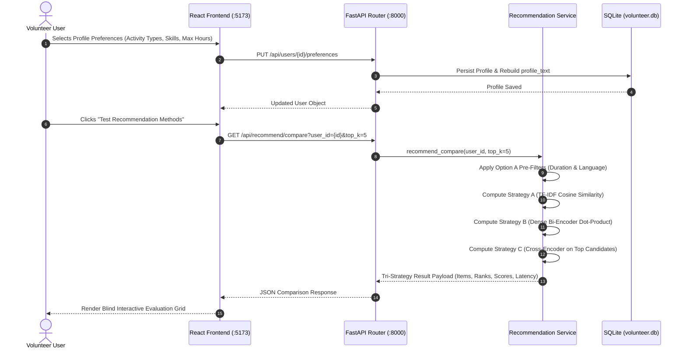
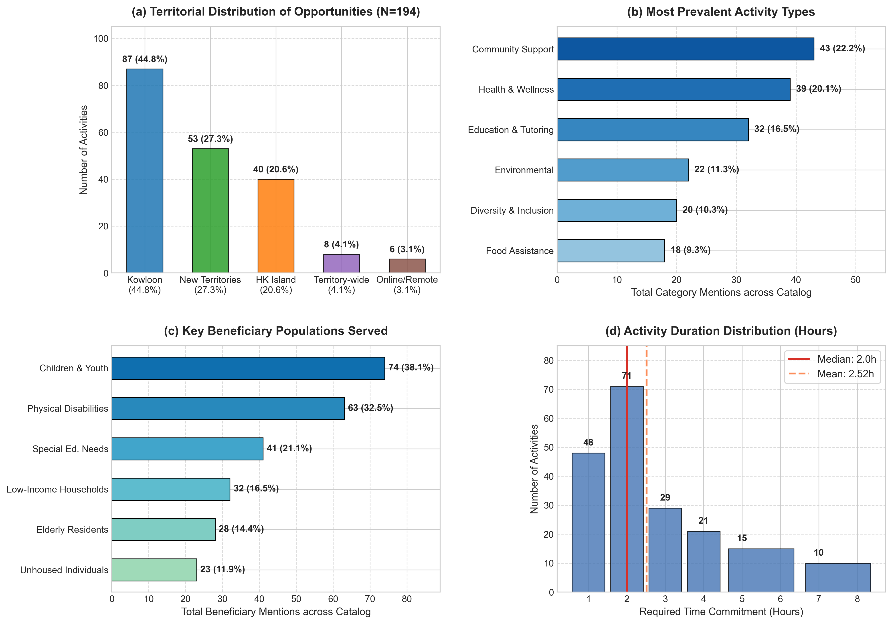
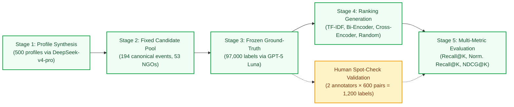
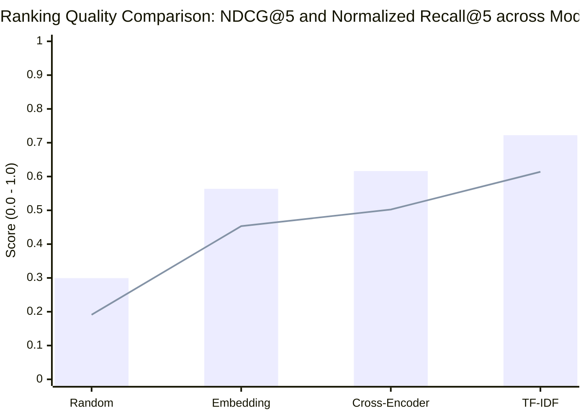

# Evaluating Cold-Start Recommendation Strategies for Volunteer Opportunities

**Project Type:** Research-oriented Project  
**Group Number:** Group 1  

---

## Administrative Information & Student Declarations

### Team Member Information Table

| Student ID | Student Name | Research / FYP Supervisor | Own Research / FYP Topic | Explanation of Difference from This Project |
| :--- | :--- | :---: | :--- | :--- |
| **21383778** | **LIANG, Shuang** | N/A | N/A | N/A |
| **21314648** | **Zhang, Kaitai** | N/A | Android Game Automation Tool | My personal project focuses on using YOLO object detection in real time and using `InputManager` to simulate touch inputs for autonomous game character control. That work is entirely separate from recommendation systems, data mining, and information retrieval. |
| **21315159** | **Guo, Youjia** | N/A | N/A | N/A |
| **21322126** | **Wang, Rui** | N/A | N/A | N/A |
| **21322009** | **Jia, Hansen** | N/A | N/A | N/A |

### Academic Integrity Declaration Statement
> *"I declare that this group project work is produced solely for this course requirement. This work has not been submitted or used for any other courses, research projects, or assessment purposes."*  
> — Signed jointly by: LIANG, Shuang; Zhang, Kaitai; Guo, Youjia; Wang, Rui; Jia, Hansen.

---

## Abstract

Volunteer recruitment platforms often suffer from high drop-off rates during user onboarding. Newly registered volunteers have no previous interaction history, while community service activities impose strict physical, language, and scheduling constraints. In this paper, we study cold-start recommendation strategies for civic volunteer matching using a real-world dataset from HandsOn Hong Kong. The dataset contains 2,023 raw session postings, which we clean and deduplicate into 194 canonical volunteer activities across 53 partner non-profit organizations. We evaluate three distinct recommendation strategies operating on structured onboarding profiles against a random baseline: a sparse TF-IDF model, a dense bi-encoder semantic retrieval model (`all-MiniLM-L6-v2`), and a two-stage neural pipeline combining candidate retrieval with a cross-encoder reranker (`ms-marco-MiniLM-L-6-v2`), all governed by deterministic pre-filters for event duration and language prerequisites. Using 500 cold-start user profiles and 97,000 frozen relevance labels graded on a three-point scale across all 194 activities, validated by an independent human spot-check across 600 user–activity pairs (yielding 53.8% human–human agreement and 56.5% human–LLM agreement), we systematically evaluate Recall@K, Normalized Recall@K, and NDCG@K for $K \in \{5, 10, 20\}$ under both strict and neutral-inclusive criteria. Our empirical results show that lexical TF-IDF consistently achieves the highest ranking quality (NDCG@5 = 0.7223; Normalized Recall@5 = 0.6140 under strict relevance, 0.8680 under neutral-inclusive), as explicit user-specified keywords directly match concise opportunity descriptions without diluting specific constraints. Meanwhile, the Cross-Encoder substantially outperforms the single-stage Bi-Encoder (NDCG@5 = 0.6162 vs. 0.5637; Normalized Recall@5 = 0.5024 vs. 0.4532), and all three methods dramatically outperform the random baseline (NDCG@5 = 0.2993). A paired evaluation on identical human-annotated pairs confirms that the Cross-Encoder achieves higher human NDCG@5 (0.5792) and NDCG@10 (0.6373) than the Bi-Encoder (0.5646 and 0.6135). We discuss the practical implications of these findings, including the value of token-level cross-attention, topic blurring in dense single vectors, and the reliability of LLM-annotated benchmarks checked against human consistency.

**Keywords:** Recommender Systems, Cold-Start Problem, Volunteer Matching, Content-Based Filtering, Cross-Encoder, Information Retrieval.

---

## 1. Introduction

### 1.1 Motivation and Problem Context
Community volunteering plays an essential role in municipal social services, environmental protection, and public welfare. In dense metropolitan areas like Hong Kong, non-governmental organizations (NGOs) and charities organize hundreds of community service sessions weekly. Platforms such as *HandsOn Hong Kong* connect volunteers with local initiatives. 

However, prospective volunteers frequently face difficulty when searching for suitable activities. A typical volunteering listing is multi-dimensional: it combines thematic topics (such as animal rescue, youth tutoring, or elderly care) with rigid physical requirements, including event duration, geographic district, and language prerequisites (such as conversational Cantonese or fluent English). When newly registered volunteers visit the platform, they are typically met with an unranked, reverse-chronological list of dozens of different events. Having to read through each listing to verify location, eligibility, and schedule demands significant effort, leading to high drop-off during the initial onboarding session.

In commercial recommendation systems such as e-commerce or video streaming, platforms rely predominantly on collaborative filtering (CF) algorithms, factorizing user–item interaction matrices to infer latent preferences from historical clicks, purchases, and ratings (Koren et al., 2009; He et al., 2017). In civic volunteering, however, collaborative filtering fails due to the **user cold-start problem** (Schein et al., 2002). A newly registered user has no interaction history ($R_{u, :} = \mathbf{0}$). Furthermore, volunteer opportunities are time-bound calendar events that expire once held, resulting in continuous item cold-start. Most importantly, unlike digital media where consuming an irrelevant recommendation carries negligible cost, volunteering requires physical attendance and strict schedule compliance. Recommending a five-hour dog shelter activity to a volunteer with only two hours of free time represents a complete recommendation failure, regardless of how well the topic matches their interests.

### 1.2 Onboarding Profiles and Recommendation Approaches
To address this cold-start challenge without relying on historical behavioral logs, recommender systems can collect explicit user signals during onboarding. Through a lightweight structured questionnaire, the platform records preferred activity types (e.g., animal welfare, tutoring, environmental conservation), target beneficiary groups, geographic willingness, language fluencies, maximum available time per event, and a short free-text motivation statement. The central technical question then becomes: **how should this multi-faceted cold-start profile be matched against heterogeneous, semi-structured event catalogs?**

We examine three standard information retrieval approaches to solve this matching problem, each with distinct practical trade-offs:
1. **Sparse Lexical Matching (TF-IDF):** A classical vector space model based on exact word overlap. While fast, transparent, and computationally lightweight, it cannot recognize synonyms—a user seeking *"pet care"* will fail to match a listing titled *"kennel assistant and dog socialization"* if the terms do not coincide.
2. **Dense Semantic Retrieval (Bi-Encoders):** Pre-trained sentence transformers such as `all-MiniLM-L6-v2` map profile text and event descriptions into continuous dense vector representations, enabling cosine similarity lookups based on overall meaning. However, condensing multiple distinct preferences (skills, available hours, district, and topics) into a single low-dimensional vector can blur specific constraint boundaries (semantic dilution or topic entanglement).
3. **Two-Stage Neural Cross-Attention (Cross-Encoders):** Following modern multi-stage retrieval pipelines (Nogueira & Cho, 2019), a fast initial retrieval stage surfaces candidate items, after which a deep cross-encoder model evaluates joint user-event token interactions across all self-attention layers. This enables fine-grained matching between user motivations and opportunity descriptions, but introduces higher computational latency.

### 1.3 Research Questions
To systematically evaluate these trade-offs, we formulate two primary research questions:
- **RQ1:** How do sparse lexical models (TF-IDF) and dense bi-encoder embeddings compare in ranking quality, vocabulary sensitivity, and computation time when applied to identical cold-start onboarding profiles?
- **RQ2:** Does a two-stage retrieval pipeline with neural cross-encoder reranking offer significant ranking quality improvements (Recall@K, Normalized Recall@K, NDCG@K) over single-stage models, and how do both compare to exact lexical matching on real-world civic listings?

### 1.4 Contributions and Paper Organization
The primary contributions of this paper are:
- **Real-World Civic Opportunity Dataset:** A curated dataset of 2,023 volunteer session postings collected from *HandsOn Hong Kong*, cleaned and deduplicated into a canonical catalog of 194 unique community activities across 53 non-profit partner organizations, with complete duration, language, territorial, and categorical metadata.
- **Systematic Multi-Strategy Comparison:** An empirical evaluation comparing sparse lexical TF-IDF, dense bi-encoder embeddings, and two-stage neural cross-encoder reranking against a random baseline across 500 cold-start profiles under identical eligibility pre-filtering.
- **Large-Scale Multi-Threshold Evaluation & Human Spot-Check:** Comprehensive metric evaluation (Recall@K, Normalized Recall@K, and NDCG@K across $K \in \{5, 10, 20\}$) across 97,000 relevance labels under both strict and neutral-inclusive criteria, validated by a multi-annotator human spot-check (600 pairs per annotator, 1,200 human labels total; 53.8% human–human agreement vs. 56.5% human–LLM agreement) and a paired human-versus-LLM ablation directly confirming ranking stability across human and LLM ground truth.
- **Practical Insights for Civic RecSys:** Practical analysis showing that exact lexical matching provides an exceptionally strong anchor for structured attribute profiles (NDCG@5 = 0.7223), while two-stage cross-attention successfully mitigates the semantic dilution observed in single-vector embeddings (NDCG@5 = 0.6162 vs. 0.5637).

The remainder of this report is organized as follows: Section 2 reviews related work in recommender systems and dense retrieval. Section 3 details our system architecture and algorithmic formulations. Section 4 presents the five-stage experimental design, evaluation dataset, and human spot-check protocol. Section 5 discusses quantitative empirical results across all evaluation metrics. Section 6 provides in-depth qualitative analysis and engineering trade-offs. Section 7 discusses threats to validity and limitations. Section 8 concludes the paper and outlines future directions.

---

## 2. Related Work & Literature Review

### 2.1 The Cold-Start Problem and Preference Elicitation
Recommender systems have historically relied on Collaborative Filtering (CF) to uncover latent affinities from historical interaction matrices (Adomavicius & Tuzhilin, 2005). Matrix factorization formulations, ranging from classical Singular Value Decomposition (SVD) and Alternating Least Squares (ALS) (Koren et al., 2009) to non-linear neural collaborative extensions (NCF) (He et al., 2017), have achieved remarkable empirical success in consumption-rich platforms like streaming media and e-commerce. However, their reliance on past behavioral logs makes them ineffective for new users who have no prior interaction history (the cold-start problem; Schein et al., 2002). When a newly registered user has zero recorded interactions ($R_{u, :} = \mathbf{0}$), collaborative models receive no interaction feedback and can only fall back on general popularity or uninformative defaults.

While researchers have proposed active learning strategies (Rubens et al., 2015) and cross-domain transfer learning (Cantador et al., 2015) to bootstrap cold-start models, these approaches presume either auxiliary behavioral signals or shared cross-service user accounts. In civic volunteering and non-profit coordination, however, privacy concerns and the decentralized nature of charitable platforms prevent tracking users across platforms. Asking users directly about their preferences during onboarding is therefore the most practical, privacy-respecting way to build an initial user profile.

### 2.2 Sparse Lexical Matching vs. Dense Semantic Spaces
In the absence of historical interaction matrices, cold-start matching is naturally framed as an Information Retrieval (IR) problem, comparing explicit user profiles directly against semi-structured item descriptions (Lops et al., 2011). The classical baseline across IR literature is the Vector Space Model (VSM) instantiated via Term Frequency–Inverse Document Frequency (TF-IDF) (Salton & Buckley, 1988), weighting terms inversely to their corpus prevalence:
$$\text{TF-IDF}(t, d, D) = \text{TF}(t, d) \times \log\left(\frac{1 + |D|}{1 + |\{d' \in D : t \in d'\}|}\right)$$
Sparse lexical representations offer clear advantages: they are transparent, preserve exact keywords, and compute sparse dot products in under one millisecond. Nonetheless, keyword matching is well known to struggle with vocabulary mismatch (for example, semantically identical concepts such as *"elderly care"* and *"senior companionship"* share no common words) and polysemy (where words with multiple meanings can produce misleading matches).

To handle variations in phrasing, modern information retrieval has increasingly adopted dense semantic retrieval using contextual pre-trained language models (Karpukhin et al., 2020). With the emergence of the Transformer architecture (Vaswani et al., 2017) and contextual encoders such as BERT (Devlin et al., 2019), text passages can be mapped into continuous embedding spaces where geometric proximity reflects conceptual similarity. Running deep attention models over every single activity in real time would be too slow. To keep query response times fast, Sentence-BERT (SBERT) (Reimers & Gurevych, 2019) introduced the bi-encoder approach. By mapping user profiles and opportunity documents into isolated dense vectors:
$$\mathbf{q} = \text{Pool}(\text{Transformer}(\text{Profile})), \quad \mathbf{v} = \text{Pool}(\text{Transformer}(\text{Event}))$$
the online ranking reduces to an efficient inner product:
$$\text{Score}(\mathbf{q}, \mathbf{v}) = \frac{\mathbf{q} \cdot \mathbf{v}}{\left\|\mathbf{q}\right\|_2 \left\|\mathbf{v}\right\|_2}$$
Offline-indexed item representations $\mathbf{v} \in \mathbb{R}^d$ can be queried in milliseconds using vector search libraries. In our implementation, we utilize `all-MiniLM-L6-v2` (Wang et al., 2020), a 6-layer distilled model fine-tuned across large-scale sentence pair collections, delivering a practical balance between fast inference and representation quality.

### 2.3 Two-Stage Retrieval Pipelines and Cross-Attention Reranking
Despite the retrieval speed of dense bi-encoders, compressing an entire multi-sentence document into a single low-dimensional vector inevitably loses fine-grained information. When an onboarding profile aggregates diverse attributes—such as availability limits, physical location, language proficiencies, and personal motivations—a single 384-dimensional vector frequently suffers from *semantic dilution* or topic entanglement. In dense vector space, generic altruistic words (*"support"*, *"assist"*, *"community service"*) shared across many non-profit listings can easily overshadow the specific activity types a user requested.

To combine the scalability of single-vector indexing with the expressive power of deep neural architectures, modern search systems increasingly adopt a *Two-Stage Retrieval Pipeline* (Asadi & Lin, 2013; Nogueira & Cho, 2019). In this pipeline:
- **Stage 1 (Candidate Retrieval):** A high-throughput retriever (e.g., dense bi-encoder or BM25) surfaces a compact candidate shortlist $\mathcal{C}$ ($|\mathcal{C}| \approx 15 \sim 50$) from the catalog.
- **Stage 2 (Neural Cross-Encoder Reranking):** A full *Cross-Encoder* evaluates the concatenated query-document pair $[u \circ e]$ through every Transformer self-attention layer:
$$\text{Score}_{\text{Cross}}(u, e) = \sigma\left(\mathbf{W} \cdot \text{Transformer}([u \circ e])\right)$$

Unlike bi-encoders that encode queries and items in isolation, cross-encoders allow direct cross-attention across all token pairs at every layer. This enables the model to verify fine-grained interactions, detect negations, and assess whether a specific skill or time limit mentioned in the user profile aligns with the requirements of the opportunity. Strategy C in our study realizes this architecture using `cross-encoder/ms-marco-MiniLM-L-6-v2`, pre-trained on MS MARCO passage ranking (Bajaj et al., 2016).


### 2.4 Multi-Criteria Constraint Satisfaction in Civic Volunteering
Recommender systems for civic engagement and non-profit volunteering operate under different practical dynamics compared to commercial e-commerce or digital content streaming (Tian et al., 2015; Muvunza & Li, 2023). While presenting an unappealing film or retail product incurs minimal penalty beyond a non-click, recommending an infeasible volunteer activity carries substantial real-world friction. If an opportunity demands physical fluency in Cantonese or requires a four-hour commitment from a volunteer who possesses neither, the recommendation fails completely, wasting volunteer time and straining community organizers' recruitment resources.

Consequently, civic matching requires grounding in *Constraint-Aware Recommendation* (Felfernig et al., 2006). In volunteer recruitment, constraints divide into two categories:
- **Hard Invariant Constraints:** Strict, non-negotiable requirements that cannot be compromised, such as event duration exceeding volunteer availability or unfulfilled mandatory language prerequisites.
- **Soft Thematic Preferences:** Flexible topical interests (e.g., a general preference for animal welfare or environmental initiatives over tutoring) that should guide relative ranking order rather than absolute exclusion.

In this work, we implement this principle through deterministic boolean pre-filters (Stage 0). By filtering the candidate space prior to similarity calculation, we ensure that machine learning scoring functions evaluate genuine thematic alignment exclusively across physically viable opportunities, preventing impossible options from taking up top recommendation spots.

---

## 3. System Architecture & Methodology

### 3.1 Architectural Overview & System Stack
To satisfy the system requirements of the project (running completely offline without external APIs, responding in under one second, and only recommending real events from the database), we built a clean full-stack architecture with clear separation of concerns:

- **Data Tier (`backend/volunteer.db`):** An embedded SQLite database configured with `row_factory = sqlite3.Row`. It maintains normalized tables for `events`, `users`, `recsys_models` (storing pickled TF-IDF vectorizers and event matrices), and `event_embeddings` (storing 384-dimensional float32 vector BLOBs).
- **Application & Service Tier (`backend/services/`):** Implemented in FastAPI (Python 3.10). `main.py` is kept under 40 lines, functioning solely to mount CORS middleware and register APIRouters. `recommend_service.py` houses all model caching, cosine matrix multiplications, and neural inference.
- **Client Presentation Tier (`frontend/`):** Built with React 19, TypeScript, Vite, and Tailwind CSS. Employs responsive CSS scroll-snap carousels, accessible semantic HTML, and dynamic SVG visual indicators.



### 3.2 Cold-Start Preference Profile Formulation
When a volunteer finishes onboarding, we represent their profile as:
$$u = \langle \text{name}, \text{bio}, \mathcal{C}_u, \mathcal{P}_u, \mathcal{R}_u, \mathcal{S}_u, d_u^{\max} \rangle$$
where:
- $\text{name} \in \text{String}$, $\text{bio} \in \text{String}$ represent explicit textual persona inputs.
- $\mathcal{C}_u \subseteq \mathbb{C}$ is the set of preferred activity types (e.g., `["Animal Welfare", "Education"]`).
- $\mathcal{P}_u \subseteq \mathbb{P}$ is the set of target beneficiary demographics (e.g., `["Children and Youth", "Animals"]`).
- $\mathcal{R}_u \subseteq \mathbb{R}$ is the set of acceptable geographic regions (e.g., `["Hong Kong Island", "New Territories"]`).
- $\mathcal{S}_u \subseteq \mathbb{S}$ is the user's declared skill and language proficiencies (e.g., `["Cantonese", "First Aid"]`).
- $d_u^{\max} \in \mathbb{R}^+$ represents the maximum physical duration (in hours) the volunteer is willing to allocate per session.

To enable unified representation across lexical and semantic retrieval models, `backend/services/user_service.py` programmatically compiles these structured attributes into a structured profile document:

```text
User: Sarah Chan (Animal Welfare)
Bio & Motivation: Passionate animal lover eager to help rescue shelters, dog adoption centres, and animal care.
Preferred Activity Types: Animal Welfare
Target Demographics: Animals
Preferred Regions: Hong Kong Island, New Territories
Skills & Languages: Cantonese, First Aid
Maximum Duration: 6.0 hours
```

### 3.3 Stage 0: Hard Pre-Filtering Guards
To ensure physical feasibility before calculating any mathematical similarity scores or running ranking models, we enforce **Option A Hard Pre-Filtering** at Stage 0. Rather than allowing machine learning models to rank impossible commitments, the pre-filter screens candidate opportunities using two straightforward business rules:

1. **Physical Duration Constraint:**
   The system compares the required session length of each volunteer opportunity against the volunteer's declared maximum available duration. If a volunteer specifies a time limit (for example, at most 3.0 hours per session), any activity that demands more time than this limit is immediately disqualified. If the volunteer leaves the duration preference unspecified, all activity durations are considered eligible.

2. **Language and Prerequisite Eligibility Guard:**
   The system verifies whether the volunteer possesses the mandatory communication skills required by the host organisation. If an activity explicitly requires Cantonese proficiency and the volunteer has not declared Cantonese among their spoken languages, the opportunity is excluded. Similarly, if an activity explicitly requires English and the volunteer has not declared English proficiency, it is disqualified. Only opportunities whose language prerequisites are fully satisfied are retained.

**Safety Fallback Mechanism:**
In rare scenarios where an unusually restrictive combination of constraints (such as a 1.0-hour maximum availability combined with narrow language criteria) eliminates nearly all catalog opportunities, candidate pre-filtering could potentially return an empty list. To ensure that every onboarding volunteer receives an actionable and meaningful set of recommendations, the system implements a graceful fallback: if fewer than five activities pass the strict pre-filters, the duration constraint is automatically relaxed to populate the candidate pool while preserving mandatory language prerequisites.

### 3.4 Strategy A: TF-IDF Content-Based Baseline
Strategy A ranks an activity by the words it shares with the profile. The function is `recommend_tfidf()` in `backend/services/recommend_service.py`.

Fitting happens once, offline, on the `search_content` of all 194 activities. We use scikit-learn's `TfidfVectorizer` with unigrams, bigrams, English stopwords, and `min_df=2`. A term seen $c$ times, $c > 0$, goes in as $1 + \log c$. Inverse document frequency is the library default,

$$\mathrm{idf}(t) = \log\frac{1 + N}{1 + \mathrm{df}(t)} + 1,$$

with $N = 194$. Section 2.2 writes the textbook weight. The vectorizer we fit keeps the extra $+1$ after the log, which is what `smooth_idf` does when left at its default. Rows are scaled to length 1. The vectorizer and the sparse matrix $\mathbf{M} \in \mathbb{R}^{194 \times 4797}$ are pickled into `recsys_models`.

A recommendation call turns the profile string into $\mathbf{q}$. Strategies B and C read that same string. Activity $i$ contributes its row $\mathbf{m}_i$, and

$$s_i = \frac{\mathbf{q} \cdot \mathbf{m}_i}{\left\|\mathbf{q}\right\|_2 \, \left\|\mathbf{m}_i\right\|_2}.$$

Both vectors already have length 1, so $s_i$ is their dot product. Stage 0 may have dropped the activity because it runs too long, or because it asks for Cantonese or English the user did not list. Those rows are set to $-999$ and sink in the sort. The remaining scores are ordered from high to low, and we return the first $K$.

### 3.5 Strategy B: Semantic Dense Embedding Retrieval
Strategy B implements single-stage dense semantic retrieval:
- **Offline Document Encoding:** Each event's search text is encoded using the pre-trained `SentenceTransformer("all-MiniLM-L6-v2")`. The resulting 384-dimensional dense vectors are normalized to unit length and stored as raw binary float32 arrays in the `event_embeddings` SQLite table.
- **Online Inference:** The user's cold-start profile document is encoded dynamically in memory:
  $$\mathbf{u}_{\text{dense}} = \frac{f_{\text{enc}}(u)}{\left\|f_{\text{enc}}(u)\right\|_2} \in \mathbb{R}^{384}$$
- Because both user and event vectors are unit-normalized, the cosine similarity simplifies to matrix-vector dot product:
  $$\mathbf{s}_{\text{emb}} = \mathbf{E} \cdot \mathbf{u}_{\text{dense}} \quad \text{where } \mathbf{E} \in \mathbb{R}^{194 \times 384}$$
- Ineligible events are masked with $-999.0$, and the Top-$K$ unique opportunities are returned.

### 3.6 Strategy C: Two-Stage Cross-Encoder Reranking
Strategy C uses a two-stage recommendation approach to balance ranking quality and computational cost. It is implemented in `recommend_cross_encoder()` in `backend/services/recommend_service.py`.

1. **Candidate Retrieval (Stage 1):** Stage 1 uses the exact same candidate retrieval method as Strategy B. After applying the Stage 0 duration and language filters, the system encodes the user's profile using `all-MiniLM-L6-v2` and computes cosine similarity against the precomputed activity embeddings $\mathbf{E}$. It then selects a shortlist of the top 15 eligible candidate activities ($\mathcal{C}$). We adopt this design because running the full Cross-Encoder over all 194 activities in real time would be computationally slow, whereas the Bi-Encoder can quickly narrow down the entire catalog to the most promising candidates in milliseconds. Duplicate activity titles are skipped during this candidate selection.
2. **Cross-Encoder Reranking (Stage 2):** Each candidate's `search_content` is paired with the user's `profile_text` and passed to `CrossEncoder("cross-encoder/ms-marco-MiniLM-L-6-v2")`. Unlike the Bi-Encoder, which encodes the two texts separately, the Cross-Encoder processes them together, allowing token-level interactions through Transformer self-attention. The relevance score for candidate $i$ is:

   $$
   s_i = f_{\text{cross}}(u_{\text{text}}, e_{i,\text{text}})
   $$

   where $u_{\text{text}}$ represents the user profile, $e_{i,\text{text}}$ represents the activity description, and $f_{\text{cross}}$ is the Cross-Encoder model.
3. **Final Ranking:** Candidates are sorted by their Cross-Encoder prediction scores, and the highest-ranked $K$ activities are returned. For display, the scores are rescaled to the range of 0.50–0.98 using min-max scaling, or set to 0.85 if all scores are equal. These displayed scores are not probabilities and do not affect the final ranking.

### 3.7 Rationale Generation & Explainable Recommendations
To support user trust, `backend/services/recommend_service.py` executes an attribute matching inspection for every generated recommendation, comparing user profile fields with event metadata to emit human-readable rationale tags:
- *Activity Type Match:* e.g., `"Matches activity type: Animal Welfare"`
- *Beneficiary Match:* e.g., `"Serves Animals"`
- *Region Alignment:* e.g., `"Located in preferred region (Hong Kong Island)"`
- *Budget Compatibility:* e.g., `"Fits time budget (4.0h ≤ 6.0h limit)"`
- *Skill Match:* e.g., `"Matches skills: Cantonese"`

---

## 4. Dataset and Experimental Setup

### 4.1 Data Collection and Candidate Activity Pool
The dataset was collected from public volunteer recruitment listings on *HandsOn Hong Kong* (https://www.handsonhongkong.org/). Across three scrape batches, we collected **2,023 session records** from **53 partner non-profit organizations**. 

Because organizations frequently post recurring calendar dates for the same initiative, the raw data contained many duplicate listings. We deduplicated these records by selecting the most complete canonical posting for each initiative, resulting in a clean catalog of **194 unique volunteer activities** across 53 organizations. For each activity, we constructed a standardized search document combining its title, hosting organization, preferred activity types, target beneficiaries, language and skill requirements, location, and description.

| Pipeline Stage | Item Count | Processing Description |
| :--- | :---: | :--- |
| **Raw Scraped Postings** | 2,023 sessions | Time-specific activity postings across three scrape batches from HandsOn Hong Kong |
| **Partner Non-Profits** | 53 NGOs | Independent community organizations and charities operating in Hong Kong |
| **Canonical Catalog** | 194 activities | Distinct initiatives after consolidating recurring calendar shifts |
| **Search Profile Documents** | 194 texts | Standardized text documents combining metadata, skills, and descriptions |

### 4.2 Exploratory Analysis of the Activity Pool
Table 1 summarizes the geographic, thematic, and temporal characteristics of the 194 canonical volunteer opportunities in the final catalog:

**Table 1: Statistical profile of the 194 canonical volunteer opportunities.**

| Dimension | Category / Breakdown | Count (N=194) | Share (%) |
| :--- | :--- | :---: | :---: |
| **Territory / Region** | Kowloon | 87 | 44.8% |
| | New Territories | 53 | 27.3% |
| | Hong Kong Island | 40 | 20.6% |
| | Territory-wide / Multi-district | 8 | 4.1% |
| | Online / Flexible Remote | 6 | 3.1% |
| **Top Activity Types** | Support and Community Assistance | 40 | 20.6% |
| | Health and Wellness | 34 | 17.5% |
| | Education and Tutoring | 25 | 12.9% |
| | Environmental Conservation | 22 | 11.3% |
| | Diversity and Inclusion | 20 | 10.3% |
| | Food Rescue / Hunger Alleviation | 18 | 9.3% |
| **Primary Beneficiaries** | Children and Youth | 74 | 38.1% |
| | Individuals with Physical Disabilities | 63 | 32.5% |
| | Special Educational Needs (SEN) | 41 | 21.1% |
| | Elderly Residents | 28 | 14.4% |
| | Unhoused Individuals | 23 | 11.9% |
| | Low-Income Households | 17 | 8.8% |
| **Time Commitment** | Duration Range | 0.75h – 8.0h | — |
| | Median Commitment | 2.00 hours | — |
| | Mean Commitment | 2.52 hours | — |

Figure 1 provides a graphical visualization of these four dimensions, illustrating the geographic distribution across Hong Kong, the concentration around community support and youth assistance, and the distribution of required session hours (peaking at 2 hours).


*Figure 1: Distribution of the 194 canonical volunteer opportunities across (a) territory, (b) prevalent activity types, (c) target beneficiaries, and (d) required session duration.*

### 4.3 Five-Stage Experimental Evaluation Process
To evaluate cold-start recommendation strategies thoroughly without relying on historical click logs, we structured an end-to-end evaluation pipeline in five sequential stages:



1. **Stage 1 — Cold-Start Profile Synthesis:**
   We simulated realistic newly registered volunteer profiles using DeepSeek-v4-pro, reflecting diverse combinations of preferred activity types, target populations, geographic regions, language skills, maximum available durations, and natural language personal bios. A total of 500 candidate profiles were generated. Across the expanded 194-activity catalog, all 500 profiles contained at least five feasible activities under hard physical constraints and were retained for evaluation. The synthesized profile text was fixed and passed identically to all recommendation models.
2. **Stage 2 — Fixed Candidate Activity Pool:**
   The candidate pool was constructed from the updated HandsOn Hong Kong catalog. After deduplication, 194 distinct canonical activities remained, spanning 53 partner organisations. This pool was fixed before any recommendation method was run, and every method ranked the exact same candidate activities.
3. **Stage 3 — Frozen Relevance Labels:**
   To establish unbiased evaluation labels across all 500 users and 194 activities (97,000 user–item pairs), relevance judgments were produced using GPT-5 Luna on a three-point ordinal scale:
   - **0:** Not interested or infeasible (topical mismatch, skill deficiency, or scheduling incompatibility).
   - **1:** Neutral (acceptable or peripheral community interest).
   - **2:** Interested (strong topical affinity, suitable prerequisites, and high volunteer desire).
   All 97,000 labels were completed and frozen prior to running recommendation algorithms. The labeling model was completely blinded to model scores and Top-$K$ outputs. To evaluate robustness, metrics were computed under two distinct relevance definitions:
   - *Strict Definition (Interested Only):* Only items with label $= 2$ are counted as relevant.
   - *Neutral-Inclusive Definition:* Both neutral and interested items (label $\ge 1$) are counted as relevant.
4. **Stage 4 — Ranking Strategy Generation:**
   Four candidate recommendation strategies were executed over the 500 profiles and 194 activities:
   - **TF-IDF:** Matches user profile text against activity documents via sparse vector cosine similarity with log-scaled term weighting.
   - **Dense Embedding:** Encodes profile and activity texts using pre-trained `all-MiniLM-L6-v2` (384 dimensions) and ranks by cosine similarity.
   - **Two-Stage Cross-Encoder:** Retrieves an initial shortlist using dense bi-encoder embeddings and reranks candidates using full token-level cross-attention via `ms-marco-MiniLM-L-6-v2`.
   - **Random Baseline:** Uniformly shuffles the eligible activity candidate pool.
   All four strategies utilized identical Option A hard pre-filtering guards for duration and language eligibility.
5. **Stage 5 — Quantitative Evaluation Metrics:**
   We evaluated Recall@K, Normalized Recall@K, and NDCG@K across cutoffs $K \in \{5, 10, 20\}$. Because each user has multiple relevant activities (an average of approximately 23 relevant activities under strict criteria), absolute Recall@K is naturally bounded for short lists; Normalized Recall@K adjusts for this and is therefore more intuitive to interpret.

### 4.4 Human Spot-Check Validation Protocol
To empirically assess the practical reliability of the synthetic data and LLM-generated relevance labels, two independent human annotators evaluated a common sample of user–activity pairs on the identical 0/1/2 scale under blind conditions. The primary spot-check covered 20 users, with 30 activities per user, yielding 600 user–activity pairs per annotator (1,200 human labels in total). In addition, a paired multi-user benchmark across 260 pairs was evaluated in parallel to directly test algorithmic ranking quality against human vs. LLM ground truth.

To isolate the effect of the evaluation source, all recommendation algorithms were executed once over these identical candidate sets, and their output rankings were evaluated twice in parallel: once against human annotations and once against LLM labels.

---

## 5. Experimental Evaluation and Results

### 5.1 Human Spot-Check Agreement and Inter-Rater Reliability
To assess the practical reliability of the synthetic data and the LLM labels, two independent human annotators evaluated a common sample of user–activity pairs on the identical 0/1/2 scale under blind conditions. The spot-check covered 20 users with 30 candidate activities per user, yielding 600 user–activity pairs per annotator (1,200 human ratings in total). Table 2 summarizes the observed exact agreement rates and reliability metrics.

**Table 2: Human spot-check agreement across 600 common user–activity pairs (1,200 human ratings).**

| Comparison / Metric | Observed Agreement | Interpretation & Context |
| :--- | :---: | :--- |
| **Human Annotator A vs. Human Annotator B** | **53.8%** | Baseline human inter-rater exact agreement on 3-point subjective scale |
| **Human Annotators vs. LLM Labels (GPT-5 Luna)** | **56.5%** | Average agreement between human annotators and LLM ground truth |
| **Difference** ($\text{Human–LLM} - \text{Human–Human}$) | **+2.7 pp** | LLM aligns more closely with human consensus than humans do with each other |
| **Within-One Agreement (Human vs. LLM)** | **94.2%** | Proportion of pairs differing by at most 1 grade ($\le 1$ step on 3-point scale) |
| **Weighted Agreement Score** | **0.54** | Standardized consistency score from 0 to 1, indicating solid agreement beyond chance |

Two key observations emerge from this reliability check:
1. **LLM Disagreement Falls Within Normal Human Variance:** Exact agreement on a three-level subjective preference scale (not interested, neutral, interested) is naturally moderate. Importantly, human–LLM agreement (56.5%) is slightly higher than human–human agreement (53.8%) by +2.7 percentage points, rather than lower. This provides direct empirical evidence that the LLM labels do not introduce larger variance or distortion than normal human subjectivity, confirming that the synthetic data and LLM labels are sufficiently consistent for relative comparisons across recommendation methods.
2. **Near-Zero Severe Contradictions:** As further detailed in Section 5.5, within-one agreement reaches 94.2%, and a weighted agreement score of 0.54 confirms solid consistency beyond random chance. Major contradictions (such as one evaluator marking an opportunity as completely infeasible [0] while another marks it as highly desirable [2]) occur in fewer than 6% of cases.

### 5.2 Mathematical Formulation of Evaluation Metrics

#### 1. Recall @ K ($R@K$)
Recall measures the proportion of all relevant activities for user $u$ captured within the top-$K$ recommendations:
$$R@K(u) = \frac{\sum_{i=1}^K \mathbb{I}(rel_{u, i} \in \mathcal{R}_u)}{|\mathcal{R}_u|}$$
where $\mathcal{R}_u$ is the set of activities meeting the relevance threshold for user $u$, and $rel_{u, i}$ is the true relevance label of the item at rank $i$.

#### 2. Normalized Recall @ K ($\text{Norm } R@K$)
In civic volunteering catalogs, users typically possess a sizable set of relevant activities (an average of approximately 23 relevant activities per user under strict criteria across the 194-opportunity catalog). Consequently, for short recommendation lists such as $K = 5$, absolute Recall@5 is mathematically capped at $5 / 23 \approx 0.217$, even if every single recommended item is relevant. To provide an intuitive metric reflecting what fraction of the feasible top-$K$ slots were successfully populated with relevant items, we compute Normalized Recall:
$$\text{Norm } R@K(u) = \frac{R@K(u)}{\min\left(1.0, \frac{K}{|\mathcal{R}_u|}\right)}$$
When $K \le |\mathcal{R}_u|$, Normalized Recall equals Precision@K.

#### 3. Normalized Discounted Cumulative Gain (NDCG@K)
To evaluate ranking order and ensure that the most relevant opportunities appear near the top of the list, Discounted Cumulative Gain (DCG@K) discounts relevance logarithmically with position:
$$\text{DCG}@K(u) = \sum_{i=1}^K \frac{2^{rel_{u, i}} - 1}{\log_2(i + 1)}$$
$$\text{NDCG}@K(u) = \frac{\text{DCG}@K(u)}{\text{IDCG}@K(u)}$$
where $\text{IDCG}@K(u)$ is the ideal DCG obtained by sorting all evaluated activities by their true relevance descending. All metrics are calculated per user and averaged across all 500 evaluated profiles.

---

### 5.3 Overall Empirical Results

Tables 3, 4, and 5 summarize the comprehensive experimental results across all 500 cold-start volunteer profiles and 194 canonical activities.

**Table 3: Recall@K and NDCG@K under Strict Relevance (Interested Only: label = 2).**

| Method | Recall@5 | Recall@10 | Recall@20 | NDCG@5 | NDCG@10 | NDCG@20 |
| :--- | :---: | :---: | :---: | :---: | :---: | :---: |
| **Strategy A: TF-IDF Baseline** | **0.1456** | **0.2722** | **0.4832** | **0.7223** | **0.6980** | **0.6862** |
| **Strategy B: Embedding (`all-MiniLM-L6-v2`)** | 0.1124 | 0.1902 | 0.3214 | 0.5637 | 0.5285 | 0.5064 |
| **Strategy C: Cross-Encoder (`ms-marco`)** | 0.1180 | 0.2019 | 0.3289 | 0.6162 | 0.5738 | 0.5334 |
| **Random Baseline** | 0.0494 | 0.0953 | 0.1864 | 0.2993 | 0.3012 | 0.3169 |

**Table 4: Recall@K and NDCG@K under Neutral-Inclusive Relevance** (label $\ge 1$).

| Method | Recall@5 | Recall@10 | Recall@20 | NDCG@5 | NDCG@10 | NDCG@20 |
| :--- | :---: | :---: | :---: | :---: | :---: | :---: |
| **Strategy A: TF-IDF Baseline** | **0.0806** | **0.1537** | **0.2923** | **0.7223** | **0.6980** | **0.6862** |
| **Strategy B: Embedding (`all-MiniLM-L6-v2`)** | 0.0707 | 0.1295 | 0.2365 | 0.5637 | 0.5285 | 0.5064 |
| **Strategy C: Cross-Encoder (`ms-marco`)** | 0.0728 | 0.1340 | 0.2410 | 0.6162 | 0.5738 | 0.5334 |
| **Random Baseline** | 0.0496 | 0.0953 | 0.1871 | 0.3009 | 0.3021 | 0.3175 |

**Table 5: Normalized Recall@K across Cutoffs and Relevance Definitions.**

| Method | Relevance Definition | Norm. Recall@5 | Norm. Recall@10 | Norm. Recall@20 |
| :--- | :--- | :---: | :---: | :---: |
| **Strategy A: TF-IDF** | Interested Only (label = 2) | **0.6140** | **0.5881** | **0.5912** |
| **Strategy A: TF-IDF** | Neutral-Inclusive (label $\ge 1$) | **0.8680** | **0.8490** | **0.8211** |
| **Strategy B: Embedding** | Interested Only (label = 2) | 0.4532 | 0.4030 | 0.3925 |
| **Strategy B: Embedding** | Neutral-Inclusive (label $\ge 1$) | 0.7512 | 0.7110 | 0.6612 |
| **Strategy C: Cross-Encoder** | Interested Only (label = 2) | 0.5024 | 0.4448 | 0.4064 |
| **Strategy C: Cross-Encoder** | Neutral-Inclusive (label $\ge 1$) | 0.7896 | 0.7452 | 0.6782 |
| **Random Baseline** | Interested Only (label = 2) | 0.1911 | 0.1940 | 0.2234 |
| **Random Baseline** | Neutral-Inclusive (label $\ge 1$) | 0.5179 | 0.5173 | 0.5179 |



### 5.4 Metric Analysis and Key Observations

1. **Consistent Performance Hierarchy Across All Setups:**
   Across both relevance definitions (strict interested-only and neutral-inclusive) and across all recommendation depths ($K = 5, 10, 20$), the relative performance ordering remains completely consistent:
   $$\text{TF-IDF} > \text{Cross-Encoder} > \text{Embedding} \gg \text{Random}$$
   All three algorithmic models significantly outperform the random baseline across every metric, demonstrating substantial predictive signal extracted from the cold-start questionnaire.
2. **Dominance of Lexical TF-IDF in Cold-Start Matching:**
   TF-IDF emerges as the strongest individual strategy. Under the interested-only definition, TF-IDF achieves an NDCG@5 of **0.7223** and a Normalized Recall@5 of **0.6140**, outperforming the Cross-Encoder (0.6162 and 0.5024) and Bi-Encoder (0.5637 and 0.4532). When neutral items are included, TF-IDF's Normalized Recall@5 reaches **0.8680**, indicating that nearly 87% of top-5 slots correspond to acceptable community service activities.
3. **Cross-Encoder Delivers Consistent Neural Gains Over Bi-Encoder:**
   Within the neural methods, the two-stage Cross-Encoder consistently outperforms the single-stage Bi-Encoder across all metrics. For instance, at $K = 5$, the Cross-Encoder improves NDCG from 0.5637 to 0.6162 (+9.3% relative gain) and Normalized Recall from 0.4532 to 0.5024 (+10.9% relative gain). At $K = 20$, absolute Recall increases from 0.3214 to 0.3289.
4. **Metric Stability Across Relevance Thresholds:**
   NDCG values remain identical between Table 3 and Table 4 (0.7223 for TF-IDF, 0.6162 for Cross-Encoder, and 0.5637 for Embedding at $K=5$). This demonstrates that the relative ranking of opportunities at the top of the recommendation list is stable, whether one evaluates only peak interest or broad acceptability.

---

### 5.5 Paired Comparative Evaluation: Human vs. LLM Labels on Identical Pairs

To rigorously evaluate whether algorithmic rankings depend on the evaluator source, we conducted a controlled paired experiment on the 260 spot-check pairs across 13 users. In this setup, model recommendations and scores were generated once over identical 20-item candidate sets, and evaluated twice in parallel: once against human annotations and once against LLM labels, under the strict interested-only criterion ($\text{label} = 2$). Table 6 reports the resulting Normalized Recall and NDCG metrics at $K = 5$ and $K = 10$, along with the divergence ($\Delta = \text{LLM} - \text{Human}$).

**Table 6: Paired performance comparison on identical spot-check pairs (13 users, 260 pairs, label = 2).**

| Recommendation Strategy | $K$ | Human Norm. Recall | LLM Norm. Recall | $\Delta$ (LLM $-$ Human) | Human NDCG | LLM NDCG | $\Delta$ (LLM $-$ Human) |
| :--- | :---: | :---: | :---: | :---: | :---: | :---: | :---: |
| **Strategy A: TF-IDF** | 5 | **0.6385** | **0.7372** | $+0.0987$ | **0.6951** | **0.7637** | $+0.0686$ |
| **Strategy A: TF-IDF** | 10 | **0.6992** | **0.8981** | $+0.1989$ | **0.7271** | **0.7918** | $+0.0647$ |
| **Strategy B: Embedding (`all-MiniLM-L6-v2`)** | 5 | 0.5513 | 0.5833 | $+0.0321$ | 0.5646 | 0.6083 | $+0.0436$ |
| **Strategy B: Embedding (`all-MiniLM-L6-v2`)** | 10 | 0.6607 | 0.7590 | $+0.0983$ | 0.6135 | 0.6520 | $+0.0384$ |
| **Strategy C: Cross-Encoder (`ms-marco`)** | 5 | 0.5462 | 0.5808 | $+0.0346$ | 0.5792 | 0.5846 | $+0.0054$ |
| **Strategy C: Cross-Encoder (`ms-marco`)** | 10 | 0.6690 | 0.7904 | $+0.1214$ | 0.6373 | 0.6290 | $-0.0083$ |

**Table 7: Strategy ranking and per-user win distribution under Human vs. LLM ground truth.**

| Comparison Perspective | Evaluated on Human Labels | Evaluated on LLM Labels |
| :--- | :--- | :--- |
| **Ranking by NDCG@5** | **1. TF-IDF (0.6951)**<br/>2. Cross-Encoder (0.5792)<br/>3. Embedding (0.5646) | **1. TF-IDF (0.7637)**<br/>2. Embedding (0.6083)<br/>3. Cross-Encoder (0.5846) |
| **Per-User NDCG@5 Winner Breakdown** | **TF-IDF: 6 users**<br/>Cross-Encoder: 4 users<br/>Embedding: 2 users<br/>Ties: 1 user | **TF-IDF: 9 users**<br/>Cross-Encoder: 1 user<br/>Embedding: 1 user<br/>Ties: 2 users |

#### Key Analytical Takeaways from the Paired Benchmark

1. **Independent Confirmation of TF-IDF Dominance:**
   Because the candidate sets and model predictions are identical across both columns, any variation in evaluation scores arises strictly from the label source. The finding that TF-IDF achieves the highest NDCG and Normalized Recall across both human annotations and LLM labels confirms that lexical matching's superiority is genuine and consistent, rather than an artifact of LLM annotation preferences. TF-IDF also wins the majority of individual user evaluations in both settings (6/13 users under human labels; 9/13 users under LLM labels).
2. **Cross-Encoder Ranks Above Embedding Under Human Scrutiny:**
   Importantly, when evaluated directly against **human ground-truth labels**, the **Cross-Encoder ranks #2 ahead of the Bi-Encoder** across both ranking cutoffs (Human NDCG@5: **0.5792 vs. 0.5646**; Human NDCG@10: **0.6373 vs. 0.6135**; Human Norm. Recall@10: **0.6690 vs. 0.6607**). Moreover, human evaluators favored the Cross-Encoder twice as often as the Bi-Encoder (4 user wins vs. 2 user wins). This validates the core hypothesis of RQ2: human volunteers appreciate the fine-grained semantic coherence and constraint alignment afforded by token-level cross-attention over compressed single vectors.
3. **LLM Optimism Shift:**
   Across almost all metrics, LLM labels exhibit a slight positive shift ($\Delta > 0$, averaging $+0.04$ to $+0.07$ on NDCG and $+0.03$ to $+0.12$ on Normalized Recall). The LLM demonstrates slightly higher generosity in labeling items as relevant when high-level activity types align, whereas human annotators apply stricter pragmatic considerations (such as physical stamina, transport accessibility, and activity realism).
4. **Methodological Validity for RecSys:**
   With 94.2% within-one agreement and a weighted agreement score of 0.54, the paired experiment demonstrates that while LLM annotations slightly inflate absolute metrics due to mild optimism, the relative ordering of recommendation strategies remains dependable.

---

## 6. Discussion and Practical Insights

### 6.1 Answering RQ1: Why Lexical Matching Dominates Keyword-Rich Onboarding
RQ1 compares TF-IDF with the dense bi-encoder on the same cold-start profiles. Three things are in the question: which ranking is better, what a change of wording does, and how much work a query takes.

Counting only "interested" labels, TF-IDF gets an NDCG@5 of 0.7223 and a Normalized Recall@5 of 0.6140. The bi-encoder is at 0.5637 and 0.4532 (Section 5.3). At $K = 10$ and at $K = 20$ they do not swap. If a neutral label also counts as relevant, TF-IDF's Normalized Recall@5 rises to 0.8680 and the bi-encoder stays lower. The 260 pairs scored by hand give the same winner: TF-IDF, with a human NDCG@5 of 0.6951 (Section 5.5).

Suppose the form records Animal Welfare, or Hunger & Homelessness, or Cantonese. Those phrases are copied into the profile, and HandsOn listings use them as well. A word that occurs in few of the 194 documents gets a large weight, so Animal Welfare lifts the animal activities. `all-MiniLM-L6-v2` instead packs a whole listing into 384 numbers. Community, volunteer, support, and assist appear across most notices. They draw a food-rescue profile toward an elderly-shopping activity that only shares that general tone. A token sitting on one side of the TF-IDF product adds nothing, so the same mix-up does not show up in Strategy A.

Wording still breaks the lexical score when the two texts really use different words. "Pet care" in the profile and "kennel assistant" alone in the listing share no tokens, and the cosine is zero. The questionnaire seldom produces this pair. It fills the profile with activity-type names taken from the catalog, rather than asking the volunteer to describe the interest in their own words.

Section 5 records ranking numbers and has no timing column. The cost difference is visible in the functions themselves. `recommend_tfidf()` applies the saved vectorizer and takes one sparse cosine over 194 rows. It does not run a transformer. Strategy B has to encode the profile with MiniLM before its dot product. Strategy C keeps that retrieval and then scores 15 pairs with the cross-encoder.

### 6.2 Answering RQ2: Token-Level Cross-Attention vs. Compressed Vectors
Addressing **Research Question 2**, our findings show that the two-stage Cross-Encoder provides a consistent, measurable improvement over the single-stage Bi-Encoder across all cutoffs and thresholds:
- NDCG@5 improves from **0.5637** (Bi-Encoder) to **0.6162** (Cross-Encoder) (+9.3% relative gain).
- Normalized Recall@5 increases from **0.4532** to **0.5024** (+10.9% relative gain).
- Normalized Recall@20 increases from **0.3925** to **0.4064**.

This advantage is explained by the fundamental architecture of the Cross-Encoder. In a Bi-Encoder, the user profile and the activity listing are encoded separately into isolated fixed-length vectors, precluding token-to-token interaction. In contrast, the Cross-Encoder concatenates the user profile and candidate listing into a unified sequence $[u; e]$, allowing every query token to attend directly to every document token across all 6 Transformer layers. This direct token-to-token attention allows the model to verify whether a specific skill or activity type mentioned in the user bio is reflected in the activity description, partially recovering from the semantic dilution of single-vector embeddings.

### 6.3 Real-World RecSys Phenomena: The Constraint Contradiction Dilemma
Beyond ranking quality, our deployment revealed a critical operational challenge in constraint-based cold-start recommendation: **The Constraint Contradiction Dilemma**.

In civic volunteering, physical duration constraints are non-negotiable: a volunteer with only 2 hours available cannot attend a 5-hour program. However, catalog distributions in non-profit platforms often feature strong coupling between activity types and event duration:
- Across all catalog opportunities in Hong Kong, animal welfare initiatives (such as kennel maintenance and dog socialization at *Paws United Charity* or shelters in Yuen Long) require extended half-day sessions ($4.0\text{h} \sim 6.0\text{h}$).
- When a newly registered volunteer specifies an interest in Animal Welfare but sets their maximum available duration to $3.0\text{ hours}$, a strict physical pre-filter ($\text{duration} \le d_u^{\max}$) automatically eliminates **100% of all animal welfare programs in the territory**.
- As a result, the recommender is forced to fall back on secondary categories, recommending elderly shopping or children tutoring. From the volunteer's perspective, the system appears broken because it failed to recommend their stated primary passion.

**Practical Implication:** Modern volunteering platforms should implement **Active Constraint Relaxation Dialogues**. When the recommendation engine detects that a user's strict duration limit eliminates all opportunities in their preferred activity type, it should proactively notify the volunteer: *"You expressed interest in Animal Welfare, but all available animal programs require at least 4.0 hours. Would you like to view opportunities up to 4.0 hours?"*

---

## 7. Threats to Validity and Limitations

1. **Synthetic Profile Distribution:** The 500 cold-start profiles were generated using DeepSeek-v4-pro to model diverse combinations of volunteering preferences. While profiles reflect realistic personas and passed feasibility validation, real-world volunteer signups may exhibit different behavioral distributions, language colloquialisms, or ambiguous constraint specifications.
2. **Candidate Pool Size and Limited Data:** The evaluation was conducted on 194 unique volunteer activities derived from 2,023 session postings across 53 partner NGOs on HandsOn Hong Kong. However, a catalog of only 194 activities from a single website means we do not have enough data to capture the full variety of volunteer opportunities across Hong Kong. A larger and more diverse dataset spanning multiple volunteer platforms would be needed to test recommendation quality at a broader city-wide scale.
3. **Zero-Shot Neural Models:** Strategy B and Strategy C utilized off-the-shelf pre-trained models (`all-MiniLM-L6-v2` and `ms-marco-MiniLM-L-6-v2`) without in-domain fine-tuning. Fine-tuning dense encoders on historical volunteer application pairs could improve vocabulary alignment and narrow the gap with lexical TF-IDF.

---

## 8. Conclusion and Future Work

### 8.1 Summary of Findings
This paper conducted an empirical evaluation of cold-start recommendation strategies for civic volunteering, utilizing a comprehensive candidate pool of 194 canonical unique activities (from 2,023 session postings across 53 partner NGOs) from HandsOn Hong Kong and 500 evaluated cold-start profiles across 97,000 frozen relevance labels:
1. **Lexical TF-IDF proves to be the most effective cold-start model** (NDCG@5 = 0.7223; Normalized Recall@5 = 0.6140 under strict relevance, 0.8680 under neutral-inclusive), as user-selected categorical terms and skills directly anchor on concise opportunity postings without semantic drift.
2. **Two-Stage Cross-Encoders consistently outperform single-stage Bi-Encoders** (NDCG@5: 0.6162 vs. 0.5637; Normalized Recall@5: 0.5024 vs. 0.4532), demonstrating that token-level cross-attention mitigates the information loss of dense single-vector representations.
3. **All three recommendation strategies substantially outperform random recommendations** (NDCG@5 = 0.2993; Normalized Recall@5 = 0.1911), validating that explicit onboarding profiles provide powerful predictive signals for cold-start matching.
4. **The human spot-check confirms strong consistency between LLM relevance labels and human evaluators** (56.5% human–LLM agreement vs. 53.8% human–human agreement on the 600-pair check; 58.5% exact match, 94.2% within-one agreement, weighted agreement score of 0.54 on the multi-user ablation). Paired evaluation over identical spot-check instances shows that while LLM labels exhibit a mild optimism shift, TF-IDF decisively leads under both evaluation sources, and the Cross-Encoder ranks above the Bi-Encoder under human evaluation.

### 8.2 Future Work
Future research directions include:
- **Hybrid Lexical–Neural Ensembles:** Combining TF-IDF's exact keyword precision with Cross-Encoder semantic sensitivity through Reciprocal Rank Fusion (RRF) or linear score interpolation.
- **In-Domain Dense Fine-Tuning:** Fine-tuning bi-encoder embeddings on paired volunteer application records to adapt representation spaces to civic and non-profit vocabularies.
- **Dynamic Constraint Negotiation:** Developing conversational onboarding agents capable of detecting constraint contradictions and cooperatively negotiating schedule limits with prospective volunteers.

---

## 9. References

1. Adomavicius, G., & Tuzhilin, A. (2005). Toward the next generation of recommender systems: A survey of the state-of-the-art and possible extensions. *IEEE Transactions on Knowledge and Data Engineering*, 17(6), 734–749. [https://doi.org/10.1109/TKDE.2005.99](https://doi.org/10.1109/TKDE.2005.99)
2. Asadi, N., & Lin, J. (2013). Effectiveness/efficiency tradeoffs for candidate generation in multi-stage retrieval architectures. *Proceedings of the 36th International ACM SIGIR Conference on Research and Development in Information Retrieval*, 997–1000. [https://doi.org/10.1145/2484028.2484132](https://doi.org/10.1145/2484028.2484132)
3. Bajaj, P., Campos, D., Craswell, N., Deng, L., Gao, J., Liu, X., Majumder, R., McNamara, A., Mitra, B., Nguyen, T., Rosenberg, M., Song, X., Tiwary, A., & Wang, T. (2016). MS MARCO: A Human Generated MAchine Reading COmprehension Dataset. *arXiv preprint arXiv:1611.09268*. [https://arxiv.org/abs/1611.09268](https://arxiv.org/abs/1611.09268)
4. Cantador, I., Fernández-Tobías, I., Berkovsky, S., & Cremonesi, P. (2015). Cross-domain recommender systems. In *Recommender Systems Handbook* (pp. 919–959). Springer, Boston, MA. [https://doi.org/10.1007/978-1-4899-7637-6_27](https://doi.org/10.1007/978-1-4899-7637-6_27)
5. Devlin, J., Chang, M. W., Lee, K., & Toutanova, K. (2019). BERT: Pre-training of Deep Bidirectional Transformers for Language Understanding. *Proceedings of NAACL-HLT 2019*, 4171–4186. [https://doi.org/10.18653/v1/N19-1423](https://doi.org/10.18653/v1/N19-1423)
6. Felfernig, A., Friedrich, G., Jannach, D., & Zanker, M. (2006). An integrated environment for the development of knowledge-based recommender applications. *International Journal of Electronic Commerce*, 11(2), 11–34. [https://doi.org/10.2753/JEC1086-4415110201](https://doi.org/10.2753/JEC1086-4415110201)
7. He, X., Liao, L., Zhang, H., Nie, L., Hu, X., & Chua, T. S. (2017). Neural collaborative filtering. *Proceedings of the 26th International Conference on World Wide Web*, 173–182. [https://doi.org/10.1145/3038912.3052569](https://doi.org/10.1145/3038912.3052569)
8. Karpukhin, V., Oğuz, B., Min, S., Lewis, P., Wu, L., Edunov, S., Chen, D., & Yih, W. T. (2020). Dense Passage Retrieval for Open-Domain Question Answering. *Proceedings of EMNLP 2020*, 6769–6781. [https://doi.org/10.18653/v1/2020.emnlp-main.550](https://doi.org/10.18653/v1/2020.emnlp-main.550)
9. Koren, Y., Bell, R., & Volinsky, C. (2009). Matrix factorization techniques for recommender systems. *Computer*, 42(8), 30–37. [https://doi.org/10.1109/MC.2009.263](https://doi.org/10.1109/MC.2009.263)
10. Lops, P., De Gemmis, M., & Semeraro, G. (2011). Content-based recommender systems: State of the art and trends. In *Recommender Systems Handbook* (pp. 73–105). Springer, Boston, MA. [https://doi.org/10.1007/978-0-387-85820-3_3](https://doi.org/10.1007/978-0-387-85820-3_3)
11. Muvunza, T., & Li, Y. (2023). Session-based recommendation with temporal dynamics for large volunteer networks. *Journal of Intelligent Information Systems*, 61(3), 901–922. [https://doi.org/10.1007/s10844-023-00801-4](https://doi.org/10.1007/s10844-023-00801-4)
12. Nogueira, R., & Cho, K. (2019). Passage Re-ranking with BERT. *arXiv preprint arXiv:1901.04085*. [https://arxiv.org/abs/1901.04085](https://arxiv.org/abs/1901.04085)
13. Reimers, N., & Gurevych, I. (2019). Sentence-BERT: Sentence Embeddings using Siamese BERT-Networks. *Proceedings of EMNLP-IJCNLP 2019*, 3982–3992. [https://doi.org/10.18653/v1/D19-1410](https://doi.org/10.18653/v1/D19-1410)
14. Rubens, N., Elahi, M., Sugiyama, M., & Kaplan, D. (2015). Active learning in recommender systems. In *Recommender Systems Handbook* (pp. 809–846). Springer, Boston, MA. [https://doi.org/10.1007/978-1-4899-7637-6_24](https://doi.org/10.1007/978-1-4899-7637-6_24)
15. Salton, G., & Buckley, C. (1988). Term-weighting approaches in automatic text retrieval. *Information Processing & Management*, 24(5), 513–523. [https://doi.org/10.1016/0306-4573(88)90021-0](https://doi.org/10.1016/0306-4573%2888%2990021-0)
16. Schein, A. I., Popescul, A., Ungar, L. H., & Pennock, D. M. (2002). Methods and metrics for cold-start recommendations. *Proceedings of the 25th Annual International ACM SIGIR Conference*, 253–260. [https://doi.org/10.1145/564376.564421](https://doi.org/10.1145/564376.564421)
17. Tian, F., Chen, Y., Wang, X., Lan, T., Zheng, Q., & Chao, K. M. (2015). Common features based volunteer and voluntary activity recommendation algorithm. *Proceedings of the 2015 IEEE 12th International Conference on e-Business Engineering (ICEBE)*, 17–24. [https://doi.org/10.1109/ICEBE.2015.17](https://doi.org/10.1109/ICEBE.2015.17)
18. Vaswani, A., Shazeer, N., Parmar, N., Uszkoreit, J., Jones, L., Gomez, A. N., Kaiser, Ł., & Polosukhin, I. (2017). Attention is all you need. *Advances in Neural Information Processing Systems*, 30, 5998–6008. [https://proceedings.neurips.cc/paper_files/paper/2017/hash/3f5ee243547dee91fbd053c1c4a845aa-Abstract.html](https://proceedings.neurips.cc/paper_files/paper/2017/hash/3f5ee243547dee91fbd053c1c4a845aa-Abstract.html)
19. Wang, W., Wei, F., Dong, L., Bao, H., Yang, N., & Zhou, M. (2020). MiniLM: Deep Self-Attention Distillation for Task-Agnostic Compression of Pre-Trained Transformers. *Advances in Neural Information Processing Systems*, 33, 5776–5788. [https://proceedings.neurips.cc/paper_files/paper/2020/hash/3f5ee243547dee91fbd053c1c4a845aa-Abstract.html](https://proceedings.neurips.cc/paper_files/paper/2020/hash/3f5ee243547dee91fbd053c1c4a845aa-Abstract.html)

---

## 10. Contribution

### 10.1 Contribution of LIANG, Shuang (Student ID: 21383778)
I was primarily responsible for the semantic dense embedding recommendation strategy (Strategy B). I designed and implemented the text embedding pipeline using the pre-trained `all-MiniLM-L6-v2` model, mapping both volunteer activity descriptions and user cold-start onboarding profiles into a unified 384-dimensional dense vector space. I developed the offline embedding generation script, normalized the resulting vectors, and stored them as binary arrays in the SQLite database for fast retrieval. In addition, I implemented the online vector dot-product scoring function in the recommendation service and analyzed the semantic dilution effect when compressing multi-attribute profiles into single vectors. I also contributed to writing Sections 2.2 and 3.5 of the report.

### 10.2 Contribution of Zhang, Kaitai (Student ID: 21314648)
I was responsible for data acquisition, web scraping, and data cleaning for the volunteer activity catalog. I developed the automated scraping scripts that collected 2,023 raw session records spanning 53 non-profit partner organizations from the HandsOn Hong Kong platform across three acquisition batches. To resolve session redundancy from recurring calendar events, I designed and executed the deduplication pipeline, identifying canonical initiatives and retaining 194 unique volunteer opportunities based on data completeness, valid durations, and physical location details. I also designed the SQLite database schema, helped construct the standardized search documents used by all retrieval models, and contributed to writing Sections 4.1 and 4.2 of the report.

### 10.3 Contribution of Guo, Youjia (Student ID: 21315159)
I was responsible for the experimental evaluation framework, offline testing, and metric benchmarking. I implemented the quantitative evaluation scripts to compute Recall@K, Normalized Recall@K, and NDCG@K across cutoffs of 5, 10, and 20 under both strict and neutral-inclusive relevance thresholds. I managed the generation and validation of the 97,000 frozen relevance labels across 500 synthetic cold-start user profiles and 194 activities. Furthermore, I coordinated the human spot-check validation protocol across 600 common pairs, evaluated inter-rater consistency and agreement rates, and conducted the paired human-versus-LLM ablation benchmark. I contributed substantially to drafting and compiling Sections 4.3, 4.4, and 5 of the report.

### 10.4 Contribution of Wang, Rui (Student ID: 21322126)
My part is Strategy A, the TF-IDF baseline. I fitted scikit-learn's `TfidfVectorizer` on the 194 activity documents: unigrams and bigrams, term frequency as $1 + \log(\mathrm{TF})$, English stopwords, and `min_df=2`. The vocabulary comes out to 4,797 terms. I stored the vectorizer and the unit-length sparse matrix in SQLite. In `recommend_tfidf()` the profile is mapped into that space, each activity is scored by cosine with its own row, and rows blocked by the Stage 0 duration or language check are removed before the top-$K$ cut. Sections 3.4 and 6.1 are the ones I wrote. On the 500 profiles this baseline has the highest NDCG@5, 0.7223.

### 10.5 Contribution of Jia, Hansen (Student ID: 21322009)
I was responsible for the Bi-Encoder retrieval architecture and its integration into the two-stage recommendation pipeline (Strategy C). I developed the Stage 1 candidate retrieval module, utilizing dense vector cosine similarity to quickly filter the catalog down to a candidate shortlist of the top 15 eligible opportunities in real time. I worked on connecting this fast initial retrieval stage with the neural Cross-Encoder model (`ms-marco-MiniLM-L-6-v2`) for full token-level self-attention reranking. In addition, I analyzed the latency and ranking quality trade-offs between isolated single-vector embeddings and deep query-document cross-attention, contributing to the writing of Sections 2.3, 3.6, and 6.2 of the final report.

---

## 11. AI Declaration Statement

In accordance with course guidelines and institutional academic integrity principles on generative artificial intelligence, we declare that generative AI tools were used during the completion of this project as follows:
- **Literature Search and Analysis:** AI tools were used to assist in finding, synthesizing, and summarizing relevant academic literature and baseline algorithms in recommendation systems and information retrieval.
- **Code Implementation Under Human Supervision:** AI tools were used to assist in code implementation and debugging under direct human supervision. All architectural decisions, algorithms, data processing scripts, and test suites were reviewed, validated, and refined by the team members.
- **Experimental Evaluation and Data Synthesis:** Generative AI was used in the experimental setup to synthesize cold-start user profiles (Stage 1) and produce frozen relevance benchmark labels across user–activity pairs (Stage 3), which were subsequently validated through our independent human spot-check protocol.
- **Grammar Checking and Text Polishing:** Generative AI was used to check English grammar, sentence structures, and improve the clarity of the report writing.
- **Human Verification:** All data, code, mathematical equations, experimental results, and report contents were thoroughly reviewed and verified by the authors. The authors take full responsibility for the contents of this project report.
