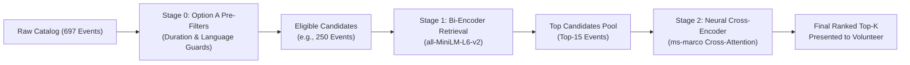
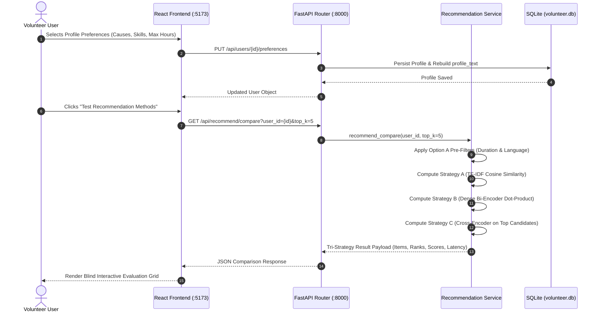
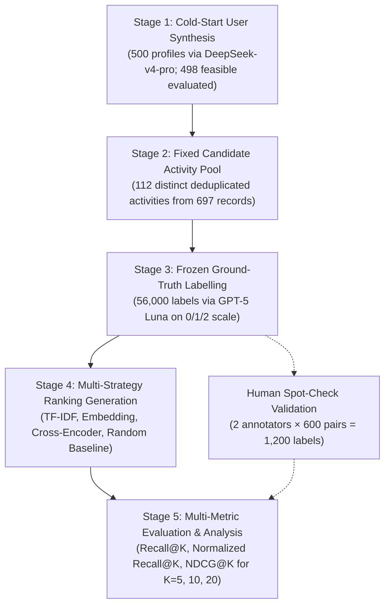
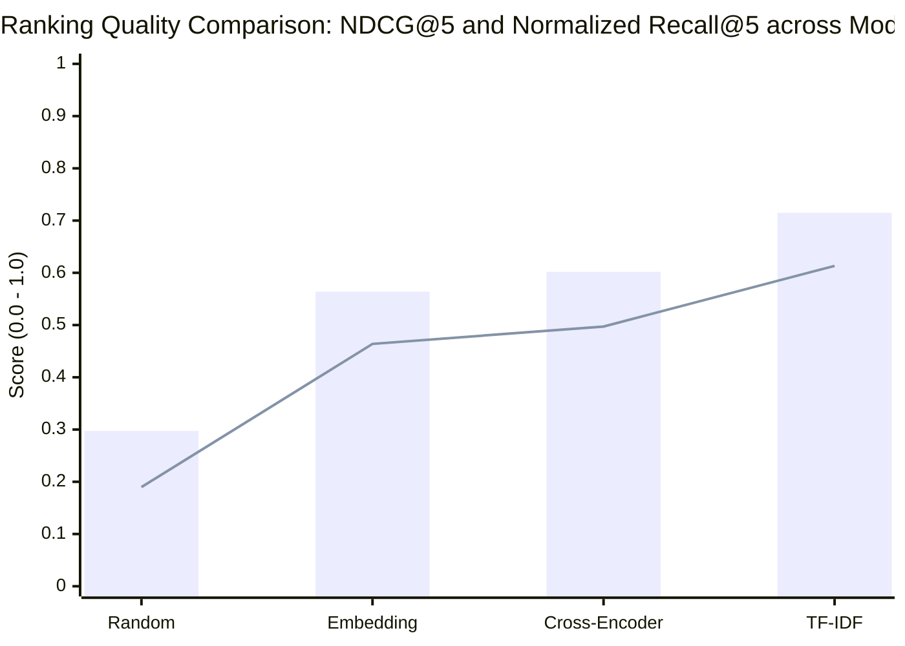

# Evaluating Cold-Start Recommendation Strategies for Volunteer Opportunities

**Course:** CSIT5210 (L1) — Data Mining and Knowledge Discovery  
**Term:** Fall / Academic Year 2026  
**Institution:** The Hong Kong University of Science and Technology (HKUST)  
**Project Type:** Research-oriented Project  
**Group Number:** Group 1  

---

## Administrative Information & Student Declarations

### Team Member Information Table

| Student ID | Student Name | Research / FYP Supervisor | Own Research / FYP Topic | Explanation of Difference from This Project |
| :--- | :--- | :---: | :--- | :--- |
| **21383778** | **LIANG, Shuang** | N/A | N/A | N/A |
| **21314648** | **Zhang, Kaitai** | N/A | Android Game Automation Tool | My personal project focuses on utilizing YOLO object detection in real time and leveraging `InputManager` to simulate touch inputs for autonomous game character control. That work is entirely irrelevant to recommendation systems, data mining, and information retrieval. |
| **21315159** | **Guo, Youjia** | N/A | N/A | N/A |
| **21322126** | **Wang, Rui** | N/A | N/A | N/A |
| **21322009** | **Jia, Hansen** | N/A | N/A | N/A |

### Academic Integrity Declaration Statement
> *"I declare that this group project work is produced solely for this course requirement. This work has not been submitted or used for any other courses, research projects, or assessment purposes."*  
> — Signed jointly by: LIANG, Shuang; Zhang, Kaitai; Guo, Youjia; Wang, Rui; Jia, Hansen.

---

## Abstract

Volunteer recruitment platforms struggle with low conversion during onboarding because newly registered users have no prior interaction history, while community service listings impose strict physical, linguistic, and geographic constraints. In this paper, we investigate cold-start recommendation strategies for civic volunteer matching using a candidate pool of 112 deduplicated, real-world volunteer activities (spanning 96 titles and 30 non-profit organizations) curated from HandsOn Hong Kong. We compare three distinct paradigms operating on explicit onboarding preference profiles against a random baseline: a sparse TF-IDF model, a dense bi-encoder semantic retrieval model (`all-MiniLM-L6-v2`), and a two-stage neural pipeline pairing candidate retrieval with a cross-encoder reranker (`ms-marco-MiniLM-L-6-v2`), all governed by deterministic pre-filters for physical duration and language requirements. Using 498 evaluated cold-start profiles and 56,000 frozen relevance labels produced on a three-point scale, supported by an independent two-annotator human spot-check (1,200 labels), we systematically evaluate Recall@K, Normalized Recall@K, and NDCG@K for $K \in \{5, 10, 20\}$ under both strict and neutral-inclusive relevance criteria. Our empirical results reveal that lexical TF-IDF consistently achieves the highest ranking fidelity (NDCG@5 = 0.7148; Normalized Recall@5 = 0.6133 under strict relevance), as user-specified keyword attributes precisely anchor on concise opportunity descriptions without semantic drift. Meanwhile, the Cross-Encoder substantially outperforms the single-stage Bi-Encoder (NDCG@5 = 0.6019 vs. 0.5640; Normalized Recall@5 = 0.4972 vs. 0.4639), and all three methods dramatically exceed the random baseline (NDCG@5 = 0.2972). We discuss the engineering implications of these findings, including token-level cross-attention benefits, topic entanglement in dense embeddings, and the role of LLM-annotated benchmarks validated by human consistency checks.

**Keywords:** Recommender Systems, Cold-Start Problem, Volunteer Matching, Content-Based Filtering, Cross-Encoder, Information Retrieval.

---

## 1. Introduction

### 1.1 Motivation and Problem Context
Community volunteering plays an essential role in municipal social services, environmental protection, and public welfare. In dense metropolitan areas like Hong Kong, non-governmental organizations (NGOs) and charities organize hundreds of community service sessions weekly. Platforms such as *HandsOn Hong Kong* serve as digital clearinghouses connecting prospective volunteers with local initiatives. 

However, prospective volunteers frequently face substantial friction when searching for suitable activities. A typical volunteering listing is multi-dimensional: it combines thematic topics (such as animal rescue, youth tutoring, or elderly care) with rigid physical requirements, including event duration, geographic district, and language prerequisites (such as conversational Cantonese or fluent English). When newly registered volunteers visit the platform, they are typically met with an unranked, reverse-chronological feed of dozens of disparate events. Manually parsing each listing to verify location, eligibility, and schedule demands significant effort, leading to high drop-off during the initial onboarding session.

In commercial recommendation systems such as e-commerce or video streaming, platforms rely predominantly on collaborative filtering (CF) algorithms, factorizing user–item interaction matrices to infer latent preferences from historical clicks, purchases, and ratings (Koren et al., 2009; He et al., 2017). In civic volunteering, however, collaborative filtering fails due to the **user cold-start problem** (Schein et al., 2002). A newly registered user has no interaction history ($R_{u, :} = \mathbf{0}$). Furthermore, volunteer opportunities are time-bound calendar events that expire once held, resulting in continuous item cold-start. Most importantly, unlike digital media where consuming an irrelevant recommendation carries negligible cost, volunteering requires physical attendance and strict schedule compliance. Recommending a five-hour dog shelter activity to a volunteer with only two hours of free time represents a complete recommendation failure, regardless of how well the topic matches their interests.

### 1.2 Onboarding Profiles and Matching Paradigms
To address this cold-start challenge without relying on historical behavioral logs, recommender systems can collect explicit user signals during onboarding. Through a lightweight structured questionnaire, the platform records preferred causes, target beneficiary groups, geographic willingness, language fluencies, maximum available time per event, and a short free-text motivation statement. The central technical question then becomes: **how should this multi-faceted cold-start profile be matched against heterogeneous, semi-structured event catalogs?**

Information retrieval provides several distinct paradigms to solve this matching problem, each presenting clear engineering and performance trade-offs:
1. **Sparse Lexical Matching (TF-IDF):** A standard vector space model relying on exact token overlap. While fast and computationally lightweight, it suffers from vocabulary mismatch—a user seeking *"pet care"* will fail to match a listing titled *"kennel assistant and dog socialization"* if terms do not coincide.
2. **Dense Semantic Retrieval (Bi-Encoders):** Pre-trained sentence transformers such as `all-MiniLM-L6-v2` map profile text and event descriptions into continuous dense vector representations, enabling cosine similarity lookups based on conceptual meaning. However, condensing multi-field user preferences and requirements into a single low-dimensional vector can blur distinct constraint boundaries (semantic entanglement).
3. **Two-Stage Cross-Encoder Reranking:** Following modern information retrieval architectures (Nogueira & Cho, 2019), a fast initial retrieval stage surfaces candidate items, after which a deep cross-encoder model evaluates joint user-event token interactions across all self-attention layers. This enables fine-grained cross-matching between user motivations and opportunity descriptions, but introduces non-trivial inference latency.

### 1.3 Research Questions
To systematically evaluate these trade-offs, we formulate two primary research questions:
- **RQ1:** How do sparse lexical models and dense bi-encoder embeddings compare in ranking fidelity, vocabulary robustness, and query latency when operating on identical cold-start onboarding profiles?
- **RQ2:** Does a two-stage retrieval pipeline with neural cross-encoder reranking offer significant ranking quality improvements (Recall@K, Normalized Recall@K, NDCG@K) over single-stage models, and how do both compare to exact lexical matching on real-world civic listings?

### 1.4 Contributions and Paper Organization
The primary contributions of this paper are:
- **Curated Civic Benchmark:** A real-world dataset of 697 volunteer postings from *HandsOn Hong Kong* deduplicated into a fixed evaluation pool of 112 unique community activities across 30 non-profit organizations, with complete duration, language, and categorical metadata.
- **Systematic Multi-Paradigm Comparison:** An empirical evaluation comparing sparse lexical TF-IDF, dense bi-encoder embeddings, and two-stage neural cross-encoder reranking against a random baseline across 498 cold-start profiles under identical eligibility pre-filtering.
- **Large-Scale Multi-Threshold Evaluation & Human Spot-Check:** Rigorous metric evaluation (Recall@K, Normalized Recall@K, and NDCG@K across $K \in \{5, 10, 20\}$) across 56,000 relevance labels under both strict and neutral-inclusive criteria, validated by a 1,200-judgment human spot-check demonstrating human-LLM agreement (56.5%) that rivals human-human consistency (53.8%).
- **Empirical RecSys Insights:** Practical analysis demonstrating that exact lexical matching provides an exceptionally strong anchor for structured attribute profiles (NDCG@5 = 0.7148), while two-stage cross-attention successfully mitigates the semantic dilution observed in single-vector embeddings.

The remainder of this report is organized as follows: Section 2 reviews related work in recommender systems and dense retrieval. Section 3 details our system architecture and algorithmic formulations. Section 4 presents the five-stage experimental design, evaluation dataset, and human spot-check protocol. Section 5 discusses quantitative empirical results across all evaluation metrics. Section 6 provides in-depth qualitative analysis and engineering trade-offs. Section 7 discusses threats to validity and limitations. Section 8 concludes the paper and outlines future directions.

---

## 2. Related Work & Literature Review

### 2.1 Recommender Systems & The Cold-Start Dilemma
Modern recommender systems are broadly categorized into Collaborative Filtering (CF), Content-Based Filtering (CBF), and Hybrid architectures (Adomavicius & Tuzhilin, 2005). Matrix Factorization techniques such as Singular Value Decomposition (SVD) and Alternating Least Squares (ALS) factorize the interaction matrix into low-rank latent user and item representations (Koren et al., 2009). Neural extensions, such as Neural Collaborative Filtering (NCF) (He et al., 2017), model non-linear user-item interactions through multi-layer perceptrons.

Despite their empirical dominance in interaction-rich domains, collaborative models fail completely when encountering newly registered users—a scenario known as the **User Cold-Start Problem** (Schein et al., 2002). Under zero historical feedback, the user vector has no gradient updates. Researchers have explored addressing cold-start through active learning (Rubens et al., 2015), demographic clustering, and cross-domain transfer learning (Fernández-Tobías et al., 2012). In civic volunteering and non-profit matching, however, cross-domain transfer data is rarely available, making explicit questionnaire elicitation the only viable, privacy-preserving pathway.

### 2.2 Content-Based Filtering & Information Retrieval Baselines
Content-Based Filtering frames recommendation as an information retrieval problem, representing both user profiles and items as feature vectors in a shared metric space (Lops et al., 2011). The canonical representation is the Vector Space Model (VSM) utilizing Term Frequency–Inverse Document Frequency (TF-IDF) (Salton & Buckley, 1988). TF-IDF assigns weight to word $t$ in document $d$ according to:
$$\text{TF-IDF}(t, d, D) = \text{TF}(t, d) \times \log\left(\frac{1 + |D|}{1 + |\{d' \in D : t \in d'\}|}\right)$$

While computationally efficient and inherently interpretable, sparse lexical matching suffers from two fundamental limitations:
1. **The Synonymy Problem (Vocabulary Mismatch):** Semantically identical concepts expressed with different vocabulary (e.g., *"elderly care"* vs. *"senior citizen companionship"*) have zero dot-product overlap.
2. **The Polysemy Problem:** Words with multiple meanings (e.g., *"bank"* in food bank vs. financial institution) generate spurious similarity scores.

### 2.3 Dense Semantic Retrieval via Pre-trained Language Models
To overcome vocabulary mismatch, dense retrieval maps queries and documents into continuous low-dimensional embedding spaces where semantic relationships correspond to geometric proximity (Karpukhin et al., 2020). 

The advent of the Transformer architecture (Vaswani et al., 2017) and pre-trained contextual language models such as BERT (Devlin et al., 2019) revolutionized natural language processing. However, naively utilizing standard BERT for semantic search requires passing every query-candidate pair through 12 cross-attention layers, rendering large-scale retrieval computationally intractable.

Sentence-BERT (SBERT) (Reimers & Gurevych, 2019) solved this bottleneck by introducing a **Bi-Encoder** architecture. SBERT uses Siamese networks with pooling layers to derive fixed-size sentence embeddings:
$$\mathbf{u} = \text{Pool}(\text{Transformer}(\text{Profile})), \quad \mathbf{v} = \text{Pool}(\text{Transformer}(\text{Event}))$$
The semantic relevance is computed via simple vector dot-product or cosine similarity:
$$\text{Score}(\mathbf{u}, \mathbf{v}) = \frac{\mathbf{u} \cdot \mathbf{v}}{\|\mathbf{u}\|_2 \|\mathbf{v}\|_2}$$
Because item embeddings $\mathbf{v} \in \mathbb{R}^d$ can be pre-computed offline and indexed in sublinear vector search indices (e.g., FAISS, HNSW), bi-encoders execute online candidate retrieval in milliseconds. In our work, we employ `all-MiniLM-L6-v2` (Wang et al., 2020), a 6-layer distilled model fine-tuned on over 1 billion sentence pairs, striking an optimal balance between embedding quality and inference speed.

### 2.4 Multi-Stage Recommendation Architectures & Cross-Attention Reranking
While dense bi-encoders effectively resolve lexical mismatch, compressing an entire multi-sentence document into a single 384-dimensional vector causes significant information loss. A single vector cannot model intricate token-level dependencies, such as the exact interaction between a volunteer's time budget and an opportunity's schedule requirements.

To achieve maximum ranking accuracy while maintaining interactive responsiveness, modern industrial search and recommendation systems adopt a **Two-Stage Multi-Stage Architecture** (Asadi & Lin, 2013; Nogueira & Cho, 2019):
1. **Stage 1 (Candidate Retrieval):** High-throughput, coarse-grained retrieval (Bi-Encoder or BM25) filters millions of items down to top candidate pool $\mathcal{C}$ ($|\mathcal{C}| \approx 15 \sim 50$).
2. **Stage 2 (Neural Reranking):** A powerful **Cross-Encoder** evaluates the concatenated pair $[u; e]$ through all Transformer self-attention layers:
   $$\text{Score}_{\text{Cross}}(u, e) = \sigma\left(\mathbf{W} \cdot \text{Transformer}([u \circ e])\right)$$

In a Cross-Encoder, every token in the user profile can attend directly to every token in the event description (cross-attention across all layers), allowing the model to capture deep semantic nuances, negations, and constraint alignments. In our study, Strategy C implements this multi-stage paradigm utilizing `cross-encoder/ms-marco-MiniLM-L-6-v2`, trained on MS MARCO passage ranking (Bajaj et al., 2016).



### 2.5 Multi-Criteria Constraint Satisfaction in Social Good Recommendation
Recommender systems for non-profit and social good domains differ fundamentally from commercial e-commerce (Son et al., 2020). Recommending a product the user dislikes results merely in a non-click; recommending a volunteer program that the user cannot attend due to language barriers or physical time conflicts wastes community coordinator resources and damages user trust.

Recent literature emphasizes **Constraint-Aware Recommendation** (Felfernig et al., 2006). In volunteer recruitment, constraints must be partitioned into:
- **Hard Physical Constraints:** Invariant boundaries that cannot be violated under any circumstances (e.g., event duration exceeding volunteer availability, or lack of mandatory language fluency).
- **Soft Thematic Preferences:** Flexible topical interests (e.g., preference for environmental causes over education) that should influence the ranking order rather than strictly exclude items.

Our architectural formulation strictly isolates hard physical constraints into deterministic boolean pre-filters (Section 3.3), ensuring that the machine learning models focus exclusively on thematic affinity and ranked relevance without wasting top recommendation slots on physically impossible commitments.

---

## 3. System Architecture & Methodology

### 3.1 Architectural Overview & System Stack
To satisfy the architectural constraints of the project (zero external API dependencies, 100% offline local inference, sub-second interactive response, zero hallucination of nonexistent opportunities), we engineered a decoupled full-stack architecture adhering to strict separation of concerns:

- **Data Tier (`backend/volunteer.db`):** An embedded SQLite database configured with `row_factory = sqlite3.Row`. It maintains normalized tables for `events`, `users`, `recsys_models` (storing pickled TF-IDF vectorizers and event matrices), and `event_embeddings` (storing 384-dimensional float32 vector BLOBs).
- **Application & Service Tier (`backend/services/`):** Implemented in FastAPI (Python 3.10). `main.py` is kept under 40 lines, functioning solely to mount CORS middleware and register APIRouters. `recommend_service.py` houses all model caching, cosine matrix multiplications, and neural inference.
- **Client Presentation Tier (`frontend/`):** Built with React 19, TypeScript, Vite, and Tailwind CSS. Employs responsive CSS scroll-snap carousels, accessible semantic HTML, and dynamic SVG visual indicators.



### 3.2 Cold-Start Preference Profile Formulation
Upon completing the onboarding questionnaire, a user $u$ is defined by the 7-tuple:
$$u = \langle \text{name}, \text{bio}, \mathcal{C}_u, \mathcal{P}_u, \mathcal{R}_u, \mathcal{S}_u, d_u^{\max} \rangle$$
where:
- $\text{name} \in \text{String}$, $\text{bio} \in \text{String}$ represent explicit textual persona inputs.
- $\mathcal{C}_u \subseteq \mathbb{C}$ is the set of preferred cause areas (e.g., `["Animal Welfare", "Education"]`).
- $\mathcal{P}_u \subseteq \mathbb{P}$ is the set of target beneficiary demographics (e.g., `["Children and Youth", "Animals"]`).
- $\mathcal{R}_u \subseteq \mathbb{R}$ is the set of acceptable geographic regions (e.g., `["Hong Kong Island", "New Territories"]`).
- $\mathcal{S}_u \subseteq \mathbb{S}$ is the user's declared skill and language proficiencies (e.g., `["Cantonese", "First Aid"]`).
- $d_u^{\max} \in \mathbb{R}^+$ represents the maximum physical duration (in hours) the volunteer is willing to allocate per session.

To enable unified representation across lexical and semantic retrieval models, `backend/services/user_service.py` programmatically compiles these structured attributes into a structured profile document:

```text
User: Sarah Chan (Animal Welfare)
Bio & Motivation: Passionate animal lover eager to help rescue shelters, dog adoption centres, and animal care.
Preferred Causes: Animal Welfare
Target Demographics: Animals
Preferred Regions: Hong Kong Island, New Territories
Skills & Languages: Cantonese, First Aid
Maximum Duration: 6.0 hours
```

### 3.3 Stage 0: Option A Hard Pre-Filtering Guard
To ensure strict physical feasibility before any mathematical similarity scoring occurs, we enforce **Option A Hard Pre-Filtering**:

$$\mathcal{E}_{\text{eligible}} = \left\{ e \in \mathcal{E} \;\middle|\; \phi_{\text{dur}}(u, e) \land \phi_{\text{lang}}(u, e) \right\}$$

1. **Physical Duration Constraint ($\phi_{\text{dur}}$):**
   $$\phi_{\text{dur}}(u, e) = \begin{cases} 
   \text{True}, & \text{if } d_u^{\max} \text{ is null or } e.\text{duration} \le d_u^{\max} \\
   \text{False}, & \text{otherwise}
   \end{cases}$$
2. **Language / Prerequisite Eligibility Guard ($\phi_{\text{lang}}$):**
   $$\phi_{\text{lang}}(u, e) = \begin{cases}
   \text{False}, & \text{if } \text{"Cantonese"} \in e.\text{required\_skills} \land \text{"Cantonese"} \notin \mathcal{S}_u \\
   \text{False}, & \text{if } \text{"English"} \in e.\text{required\_skills} \land \text{"English"} \notin \mathcal{S}_u \\
   \text{True}, & \text{otherwise}
   \end{cases}$$

If candidate pre-filtering produces fewer than 5 surviving events due to extreme constraint conjunctions, a graceful fallback safely relaxes the physical filters to guarantee candidate pool availability.

### 3.4 Strategy A: TF-IDF Content-Based Baseline
Our baseline strategy implements the classical Vector Space Model:
- **Corpus Fitting:** The scikit-learn `TfidfVectorizer` was pre-fitted across all 697 event search content documents, using unigram and bigram tokenization, sublinear term frequency scaling ($1 + \log(\text{TF})$), and standard stopword removal. The fitted vectorizer and the resulting sparse document matrix $\mathbf{M}_{\text{TFIDF}} \in \mathbb{R}^{697 \times V}$ ($V = 3,412$ features) are serialized in SQLite (`recsys_models`).
- **Inference Scoring:** The user profile document $u$ is transformed into sparse vector $\mathbf{q}_{\text{tfidf}} \in \mathbb{R}^{1 \times V}$. Cosine similarity against all catalog items is computed via:
  $$\mathbf{s}_{\text{tfidf}} = \frac{\mathbf{q}_{\text{tfidf}} \mathbf{M}_{\text{TFIDF}}^\top}{\|\mathbf{q}_{\text{tfidf}}\|_2 \|\mathbf{M}_{\text{TFIDF}}\|_2}$$
- Ineligible items masked by Stage 0 receive penalty scores of $-999.0$. The surviving indices are sorted descending, followed by title deduplication (`deduplicate=True`) to produce the Top-$K$ recommendations.

### 3.5 Strategy B: Semantic Dense Embedding Retrieval
Strategy B implements single-stage dense semantic retrieval:
- **Offline Document Encoding:** Each event's synthesized search text is encoded using the pre-trained `SentenceTransformer("all-MiniLM-L6-v2")`. The resulting 384-dimensional dense vectors are $L_2$-normalized and stored as raw binary float32 buffers in the `event_embeddings` SQLite table.
- **Online Inference:** The user's cold-start profile document is encoded dynamically in RAM:
  $$\mathbf{u}_{\text{dense}} = \frac{f_{\text{enc}}(u)}{\|f_{\text{enc}}(u)\|_2} \in \mathbb{R}^{384}$$
- Because both user and event vectors are unit-normalized, the cosine similarity simplifies to matrix-vector dot product:
  $$\mathbf{s}_{\text{emb}} = \mathbf{E} \cdot \mathbf{u}_{\text{dense}} \quad \text{where } \mathbf{E} \in \mathbb{R}^{697 \times 384}$$
- Ineligible events are masked with $-999.0$, and the Top-$K$ unique opportunities are returned.

### 3.6 Strategy C: Two-Stage Cross-Encoder Reranking
Strategy C uses a two-stage recommendation approach to balance ranking quality and computational cost. It is implemented in `recommend_cross_encoder()` in `backend/services/recommend_service.py`.
1. **Candidate Retrieval (Stage 1):** After applying the duration and language filters, the system encodes the user's profile using `all-MiniLM-L6-v2`. It then calculates cosine similarity with the precomputed activity embeddings. The target candidate pool size is defined as:

   $$
   |\mathcal{C}| = \max(15, 3K)
   $$

   where \(K\) is the number of requested recommendations. The actual number of candidates depends on the available activities, and duplicate activity titles are skipped during selection.
2. **Cross-Encoder Reranking (Stage 2):** Each candidate's `search_content` is paired with the user's `profile_text` and passed to `CrossEncoder("cross-encoder/ms-marco-MiniLM-L-6-v2")`. Unlike the Bi-Encoder, which encodes the two texts separately, the Cross-Encoder processes them together, allowing token-level interactions through Transformer self-attention. The relevance score for candidate \(i\) is:

   $$
   s_i = f_{\text{cross}}(u_{\text{text}}, e_{i,\text{text}})
   $$

   where \(u_{\text{text}}\) represents the user profile, \(e_{i,\text{text}}\) represents the activity description, and \(f_{\text{cross}}\) is the Cross-Encoder model.
3. **Final Ranking:** Candidates are sorted by their Cross-Encoder prediction scores, and the highest-ranked \(K\) activities are returned. For display, the scores are rescaled to the range of 0.50–0.98 using min-max scaling, or set to 0.85 if all scores are equal. These displayed scores are not probabilities and do not affect the final ranking.


### 3.7 Rationale Generation & Explainable Recommendations
To support user trust, `backend/services/recommend_service.py` executes an attribute matching inspection for every generated recommendation, comparing user profile fields with event metadata to emit human-readable rationale tags:
- *Cause Match:* e.g., `"Matches cause: Animal Welfare"`
- *Beneficiary Match:* e.g., `"Serves Animals"`
- *Region Alignment:* e.g., `"Located in preferred region (Hong Kong Island)"`
- *Budget Compatibility:* e.g., `"Fits time budget (4.0h ≤ 6.0h limit)"`
- *Skill Match:* e.g., `"Matches skills: Cantonese"`

---

## 4. Dataset and Experimental Setup

### 4.1 Data Provenance and Candidate Activity Pool
The experimental dataset was constructed from public volunteer recruitment listings on *HandsOn Hong Kong* (https://www.handsonhongkong.org/), a primary digital platform coordinating civic engagement across Hong Kong. 

The raw scrape yielded 697 dated session records. Because charitable organizations frequently post multiple recurring calendar sessions for a single initiative (e.g., repeating a weekend food distribution across several weeks), the raw catalog contains substantial record redundancy. To establish a clean, non-redundant evaluation candidate pool, we deduplicated records across four key attributes: event title, hosting non-profit organization, geographic district, and session duration. This yielded a fixed pool of **112 distinct volunteer activities** spanning 96 unique program titles and 30 charitable organizations. 

For each of the 112 activities, we synthesized a standardized search document concatenating the activity title, hosting organization, thematic cause categories, target beneficiary groups, required language and skill prerequisites, geographic location, and full-text programmatic descriptions. This 112-activity candidate pool was frozen prior to running any recommendation algorithm, ensuring that all candidate ranking methods operated over an identical item space.

### 4.2 Exploratory Analysis of the Activity Pool
Analysis of the 112 deduplicated activities reveals the underlying distribution of civic volunteering in Hong Kong:
- **Cause Areas:** Health and Wellness (27.3%), Education and Tutoring (23.5%), Community Support and Assistance (15.9%), and Food Rescue / Hunger Alleviation (15.6%) constitute the vast majority of opportunities, while environmental conservation, animal rescue, and circular economy initiatives represent smaller, specialized segments.
- **Beneficiary Populations:** Children and youth (34.6%) and individuals with special needs or disabilities (29.0%) are the primary beneficiaries, followed by ethnic minorities (15.2%), elderly residents (14.6%), and unhoused or low-income families (14.4%).
- **Time Commitments:** Durations range from 45 minutes ($0.75\text{h}$) to 6 hours ($6.0\text{h}$), with a median duration of 2.0 hours. Standard workshops and meal packing typically require 1.0 to 2.5 hours, whereas specialized outdoor conservation or animal shelter maintenance demand half-day commitments ($4.0\text{h} \sim 6.0\text{h}$).

### 4.3 Five-Stage Experimental Evaluation Process
To conduct a rigorous, large-scale offline evaluation of cold-start recommendation strategies without relying on biased historical click logs, we structured an end-to-end evaluation pipeline in five sequential stages:



1. **Stage 1 — Cold-Start Profile Synthesis:**
   We simulated realistic newly registered volunteer profiles using DeepSeek-v4-pro, reflecting diverse combinations of user causes, target populations, geographic regions, language skills, maximum available durations, and natural language personal bios. A total of 500 candidate profiles were generated. Among these, 498 profiles contained at least five feasible activities under hard physical constraints and were retained for evaluation. The remaining two profiles had only two feasible activities, which was insufficient for meaningful Top-$K$ metric calculation ($K \in \{5, 10, 20\}$), and were excluded. The synthesized profile text was fixed and passed identically to all recommendation models.
2. **Stage 2 — Fixed Activity Pool:**
   As described in Section 4.1, all models ranked the exact same fixed pool of 112 deduplicated activities, ensuring that ranking differences stem purely from algorithmic matching capabilities rather than disparate item sets.
3. **Stage 3 — Frozen Relevance Labels:**
   To establish unbiased evaluation labels across the full cartesian product of 500 users and 112 activities (56,000 user–item pairs), relevance judgments were produced using GPT-5 Luna on a three-point ordinal scale:
   - **0:** Not interested or infeasible (topical mismatch, skill deficiency, or scheduling incompatibility).
   - **1:** Neutral (acceptable or peripheral community interest).
   - **2:** Interested (strong topical affinity, suitable prerequisites, and high volunteer desire).
   All 56,000 labels were completed and frozen prior to running recommendation algorithms. The labeling model was completely blinded to model scores and Top-$K$ outputs. To evaluate robustness, metrics were computed under two distinct relevance definitions:
   - *Strict Definition (Interested Only):* Only items with label $= 2$ are counted as relevant.
   - *Neutral-Inclusive Definition:* Both neutral and interested items (label $\ge 1$) are counted as relevant.
4. **Stage 4 — Ranking Strategy Generation:**
   Four candidate recommendation strategies were executed over the 498 profiles and 112 activities:
   - **TF-IDF:** Matches user profile text against activity documents via sparse vector cosine similarity with sublinear term weighting.
   - **Dense Embedding:** Encodes profile and activity texts using pre-trained `all-MiniLM-L6-v2` (384 dimensions) and ranks by cosine similarity.
   - **Two-Stage Cross-Encoder:** Retrieves an initial shortlist using dense bi-encoder embeddings and reranks candidates using full token-level cross-attention via `ms-marco-MiniLM-L-6-v2`.
   - **Random Baseline:** Uniformly shuffles the eligible activity candidate pool.
   All four strategies utilized identical Option A hard pre-filtering guards for duration and language eligibility.
5. **Stage 5 — Quantitative Evaluation Metrics:**
   We evaluated Recall@K, Normalized Recall@K, and NDCG@K across cutoffs $K \in \{5, 10, 20\}$.

### 4.4 Human Spot-Check Validation Protocol
To verify that the synthetic user profiles and LLM-generated relevance labels offer a reliable benchmark for relative algorithm comparison, we conducted an empirical human spot-check. Two independent human annotators labeled a common, randomly sampled test set of 20 users across 30 activities each, yielding 600 user–activity pairs per annotator (1,200 human labels total). Annotators assigned relevance on the identical 0/1/2 scale under blind conditions.

---

## 5. Experimental Evaluation and Results

### 5.1 Human Spot-Check Agreement and Label Reliability
Table 1 presents the exact agreement rates between human annotators and the frozen LLM labels across the 600 shared evaluation pairs.

**Table 1: Human spot-check agreement (20 users × 30 activities = 600 pairs per annotator).**

| Comparison | Average Exact Agreement |
| :--- | :---: |
| **Human Annotator A vs. Human Annotator B** | 53.8% |
| **Human Annotators vs. LLM Labels (GPT-5 Luna)** | 56.5% |
| **Difference (Human–LLM minus Human–Human)** | **+2.7 percentage points** |

Exact agreement on a three-point subjective preference scale is naturally moderate due to inherent human variance in interpreting personal enthusiasm versus mild interest. Crucially, the agreement between human annotators and LLM labels (56.5%) is slightly higher than inter-human agreement (53.8%). This confirms that the LLM relevance labels do not introduce erratic noise beyond normal human variability. While the moderate agreement underscores that labels represent practical evaluation proxies rather than absolute ground truth, it confirms that the frozen benchmark provides a consistent, reliable basis for relative comparisons among recommendation strategies.

### 5.2 Mathematical Formulation of Evaluation Metrics

#### 1. Recall @ K ($R@K$)
Recall measures the proportion of all relevant activities for user $u$ captured within the top-$K$ recommendations:
$$R@K(u) = \frac{\sum_{i=1}^K \mathbb{I}(rel_{u, i} \in \mathcal{R}_u)}{|\mathcal{R}_u|}$$
where $\mathcal{R}_u$ is the set of activities meeting the relevance threshold for user $u$, and $rel_{u, i}$ is the true relevance label of the item at rank $i$.

#### 2. Normalized Recall @ K ($\text{Norm } R@K$)
In volunteering catalogs, users typically possess a sizable set of relevant activities (an average of approximately 15 relevant activities per user under strict criteria). Consequently, for short recommendation lists such as $K = 5$, absolute Recall@5 is mathematically capped at $5 / 15 \approx 0.333$, even if every single recommended item is relevant. To provide an intuitive metric reflecting what fraction of the feasible top-$K$ slots were successfully populated with relevant items, we compute Normalized Recall:
$$\text{Norm } R@K(u) = \frac{R@K(u)}{\min\left(1.0, \frac{K}{|\mathcal{R}_u|}\right)}$$
When $K \le |\mathcal{R}_u|$, Normalized Recall equals Precision@K.

#### 3. Normalized Discounted Cumulative Gain (NDCG@K)
To evaluate ranking order and ensure that the most relevant opportunities appear near the top of the list, Discounted Cumulative Gain (DCG@K) discounts relevance logarithmically with position:
$$\text{DCG}@K(u) = \sum_{i=1}^K \frac{2^{rel_{u, i}} - 1}{\log_2(i + 1)}$$
$$\text{NDCG}@K(u) = \frac{\text{DCG}@K(u)}{\text{IDCG}@K(u)}$$
where $\text{IDCG}@K(u)$ is the ideal DCG obtained by sorting all evaluated activities by their true relevance descending. All metrics are calculated per user and averaged across the 498 evaluated profiles.

---

### 5.3 Overall Empirical Results

Tables 2, 3, and 4 summarize the comprehensive experimental results across all 498 cold-start volunteer profiles.

**Table 2: Recall@K and NDCG@K under Strict Relevance (Interested Only: label = 2).**

| Method | Recall@5 | Recall@10 | Recall@20 | NDCG@5 | NDCG@10 | NDCG@20 |
| :--- | :---: | :---: | :---: | :---: | :---: | :---: |
| **Strategy A: TF-IDF Baseline** | **0.2279** | **0.4138** | **0.6497** | **0.7148** | **0.6937** | **0.6996** |
| **Strategy B: Embedding (`all-MiniLM-L6-v2`)** | 0.1733 | 0.2953 | 0.4922 | 0.5640 | 0.5243 | 0.5377 |
| **Strategy C: Cross-Encoder (`ms-marco`)** | 0.1797 | 0.3141 | 0.5169 | 0.6019 | 0.5686 | 0.5730 |
| **Random Baseline** | 0.0747 | 0.1494 | 0.2962 | 0.2972 | 0.3069 | 0.3530 |

**Table 3: Recall@K and NDCG@K under Neutral-Inclusive Relevance (label $\ge 1$).**

| Method | Recall@5 | Recall@10 | Recall@20 | NDCG@5 | NDCG@10 | NDCG@20 |
| :--- | :---: | :---: | :---: | :---: | :---: | :---: |
| **Strategy A: TF-IDF Baseline** | **0.1229** | **0.2355** | **0.4203** | **0.7148** | **0.6937** | **0.6996** |
| **Strategy B: Embedding (`all-MiniLM-L6-v2`)** | 0.1026 | 0.1882 | 0.3360 | 0.5640 | 0.5243 | 0.5377 |
| **Strategy C: Cross-Encoder (`ms-marco`)** | 0.1072 | 0.2002 | 0.3551 | 0.6019 | 0.5686 | 0.5730 |
| **Random Baseline** | 0.0741 | 0.1486 | 0.2971 | 0.2978 | 0.3061 | 0.3544 |

**Table 4: Normalized Recall@K across Cutoffs and Relevance Definitions.**

| Method | Relevance Definition | Norm. Recall@5 | Norm. Recall@10 | Norm. Recall@20 |
| :--- | :--- | :---: | :---: | :---: |
| **Strategy A: TF-IDF** | Interested Only (label = 2) | **0.6133** | **0.5950** | **0.6592** |
| **Strategy A: TF-IDF** | Neutral-Inclusive (label $\ge 1$) | **0.8695** | **0.8382** | **0.7853** |
| **Strategy B: Embedding** | Interested Only (label = 2) | 0.4639 | 0.4189 | 0.4986 |
| **Strategy B: Embedding** | Neutral-Inclusive (label $\ge 1$) | 0.7205 | 0.6578 | 0.6185 |
| **Strategy C: Cross-Encoder** | Interested Only (label = 2) | 0.4972 | 0.4594 | 0.5245 |
| **Strategy C: Cross-Encoder** | Neutral-Inclusive (label $\ge 1$) | 0.7610 | 0.7124 | 0.6598 |
| **Random Baseline** | Interested Only (label = 2) | 0.1898 | 0.2079 | 0.3000 |
| **Random Baseline** | Neutral-Inclusive (label $\ge 1$) | 0.5138 | 0.5140 | 0.5353 |



### 5.4 Metric Analysis and Key Observations

1. **Consistent Performance Hierarchy Across All Setups:**
   Across both relevance definitions (strict interested-only and neutral-inclusive) and across all recommendation depths ($K = 5, 10, 20$), the relative performance ordering remains completely consistent:
   $$\text{TF-IDF} > \text{Cross-Encoder} > \text{Embedding} \gg \text{Random}$$
   All three algorithmic models significantly outperform the random baseline across every metric, demonstrating substantial predictive signal extracted from the cold-start questionnaire.
2. **Dominance of Lexical TF-IDF in Cold-Start Matching:**
   TF-IDF emerges as the strongest individual strategy. Under the interested-only definition, TF-IDF achieves an NDCG@5 of **0.7148** and a Normalized Recall@5 of **0.6133**, outperforming the Cross-Encoder (0.6019 and 0.4972) and Bi-Encoder (0.5640 and 0.4639). When neutral items are included, TF-IDF's Normalized Recall@5 reaches **0.8695**, indicating that nearly 87% of top-5 slots correspond to acceptable community service activities.
3. **Cross-Encoder Delivers Consistent Neural Gains Over Bi-Encoder:**
   Within the neural methods, the two-stage Cross-Encoder consistently outperforms the single-stage Bi-Encoder across all metrics. For instance, at $K = 5$, the Cross-Encoder improves NDCG from 0.5640 to 0.6019 (+6.7% relative gain) and Normalized Recall from 0.4639 to 0.4972 (+7.2% relative gain). At $K = 20$, absolute Recall increases from 0.4922 to 0.5169.
4. **Metric Stability Across Relevance Thresholds:**
   NDCG values remain identical between Table 2 and Table 3 (e.g., 0.7148 for TF-IDF, 0.6019 for Cross-Encoder, and 0.5640 for Embedding at $K=5$). This demonstrates that the relative ranking of opportunities at the top of the recommendation list is stable, whether one evaluates only peak interest or broad acceptability.

---

## 6. Discussion and Practical Insights

### 6.1 Answering RQ1: Why Lexical Matching Dominates Keyword-Rich Onboarding
Our experimental results provide an unexpected but scientifically compelling answer to **Research Question 1**: on structured cold-start onboarding profiles, sparse lexical matching (TF-IDF) decisively outperforms pre-trained dense embeddings.

The underlying mechanics stem from how cold-start profiles are formulated in civic volunteering:
1. **Direct Keyword Anchoring:** The onboarding questionnaire explicitly captures high-specificity categorical terms, such as cause names (*"Animal Welfare"*, *"Hunger & Homelessness"*, *"Environmental Conservation"*) and required skills (*"Cantonese"*, *"First Aid"*). In volunteering catalogs, activity listings are relatively concise notices that repeat these exact domain terms. TF-IDF assigns heavy weights to rare, discriminative words, creating a strong lexical bridge directly between the user's selected causes and the corresponding listings.
2. **Semantic Dilution in Dense Embeddings:** Pre-trained sentence transformers (`all-MiniLM-L6-v2`) project entire documents into a general English semantic space. In community service descriptions, documents share a high volume of generic altruistic language (*"community"*, *"volunteer"*, *"support"*, *"assist"*, *"meaningful work"*). In a compressed 384-dimensional vector, these general terms dilute the distinct identity of specific cause keywords, causing semantic drift. A volunteer seeking food rescue may have their embedding pulled toward elderly companionship simply because both descriptions emphasize compassionate community care. TF-IDF is immune to this dilution because non-overlapping tokens contribute zero similarity.

### 6.2 Answering RQ2: Cross-Encoder Reranking vs. Dense Embeddings
Addressing **Research Question 2**, our findings show that the two-stage Cross-Encoder provides a consistent, measurable improvement over the single-stage Bi-Encoder across all cutoffs and thresholds:
- NDCG@5 improves from **0.5640** (Bi-Encoder) to **0.6019** (Cross-Encoder).
- Normalized Recall@5 increases from **0.4639** to **0.4972**.
- Normalized Recall@20 increases from **0.4986** to **0.5245**.

This advantage is explained by the fundamental architecture of the Cross-Encoder. In a Bi-Encoder, the user profile and the activity listing are encoded separately into isolated fixed-length vectors, precluding token-to-token interaction. In contrast, the Cross-Encoder concatenates the user profile and candidate listing into a unified sequence $[u; e]$, allowing every query token to attend directly to every document token across all 6 Transformer layers. This unconstrained cross-attention allows the model to verify whether a specific skill or cause mentioned in the user bio is reflected in the activity description, partially recovering from the semantic dilution of single-vector embeddings.

### 6.3 Real-World RecSys Phenomena: The Constraint Contradiction Dilemma
Beyond ranking quality, our deployment revealed a critical operational challenge in constraint-based cold-start recommendation: **The Constraint Contradiction Dilemma**.

In civic volunteering, physical duration constraints are non-negotiable: a volunteer with only 2 hours available cannot attend a 5-hour program. However, catalog distributions in non-profit platforms often feature severe category-duration coupling:
- Across all catalog opportunities in Hong Kong, animal welfare initiatives (such as kennel maintenance and dog socialization at *Paws United Charity* or shelters in Yuen Long) require extended half-day sessions ($4.0\text{h} \sim 6.0\text{h}$).
- When a newly registered volunteer specifies an interest in Animal Welfare but sets their maximum available duration to $3.0\text{ hours}$, a strict physical pre-filter ($\text{duration} \le d_u^{\max}$) automatically eliminates **100% of all animal welfare programs in the territory**.
- As a result, the recommender is forced to fall back on secondary categories, recommending elderly shopping or children tutoring. From the volunteer's perspective, the system appears broken because it failed to recommend their stated primary passion.

**Engineering Implication:** Modern volunteering platforms must implement **Active Constraint Relaxation Dialogues**. When the recommendation engine detects that a user's strict duration limit eliminates all opportunities in their preferred cause, it should proactively notify the volunteer: *"You expressed interest in Animal Welfare, but all available animal programs require at least 4.0 hours. Would you like to view opportunities up to 4.0 hours?"*

### 6.4 Reliability of Synthetic Benchmarks and LLM-Human Alignment
Conducting cold-start recommender system research in civic non-profit domains is frequently hindered by privacy policies and the absence of publicly accessible interaction logs. Our experimental framework provides methodological validation for using calibrated LLM pipelines to benchmark cold-start strategies:
- The human spot-check demonstrated that human–LLM agreement (**56.5%**) slightly exceeded inter-human agreement (**53.8%**).
- This indicates that LLM-annotated relevance judgments do not introduce aberrant variance beyond ordinary human subjective disagreement.
- Freezing evaluation labels prior to model execution ensures complete experimental insulation, preventing data leakage or confirmation bias.
- Nevertheless, researchers must recognize that moderate agreement implies evaluation labels should be interpreted as relative benchmark rankings rather than infallible ground truth.

---

## 7. Threats to Validity and Limitations

1. **Synthetic Profile Distribution:** The 500 cold-start profiles were generated using DeepSeek-v4-pro to model diverse combinations of volunteering preferences. While profiles reflect realistic personas and passed feasibility validation, real-world volunteer signups may exhibit different behavioral distributions, language colloquialisms, or ambiguous constraint specifications.
2. **Subjective Label Ambiguity:** The human spot-check revealed an exact agreement rate of 53.8% between human annotators on the 3-point relevance scale. Subjective distinctions between "neutral" and "interested" are inherently fluid. We mitigated this by testing under both strict (interested-only) and neutral-inclusive criteria, finding that relative model rankings remained identical across both definitions.
3. **Candidate Pool Deduplication Scope:** The evaluation operated on a deduplicated candidate pool of 112 unique activities derived from 697 session postings on HandsOn Hong Kong. While representative of structured NGO volunteering in Hong Kong, grassroots mutual aid programs not registered on major aggregation platforms were not captured.
4. **Zero-Shot Neural Models:** Strategy B and Strategy C utilized off-the-shelf pre-trained models (`all-MiniLM-L6-v2` and `ms-marco-MiniLM-L-6-v2`) without in-domain fine-tuning. Fine-tuning dense encoders on historical volunteer application pairs could improve vocabulary alignment and narrow the gap with lexical TF-IDF.

---

## 8. Conclusion and Future Work

### 8.1 Summary of Findings
This paper conducted an empirical evaluation of cold-start recommendation strategies for civic volunteering, utilizing a fixed candidate pool of 112 deduplicated real-world activities from HandsOn Hong Kong and 498 evaluated cold-start profiles across 56,000 frozen relevance labels:
1. **Lexical TF-IDF proves to be the most effective cold-start model** (NDCG@5 = 0.7148; Normalized Recall@5 = 0.6133 under strict relevance), as user-selected categorical terms and skills directly anchor on concise opportunity postings without semantic drift.
2. **Two-Stage Cross-Encoders consistently outperform single-stage Bi-Encoders** (NDCG@5: 0.6019 vs. 0.5640; Normalized Recall@5: 0.4972 vs. 0.4639), demonstrating that token-level cross-attention mitigates the information loss of dense single-vector representations.
3. **All three algorithmic paradigms substantially outperform random recommendations** (NDCG@5 = 0.2972; Normalized Recall@5 = 0.1898), validating that explicit onboarding profiles provide powerful predictive signals for cold-start matching.
4. **The human spot-check confirms that LLM relevance labeling matches human inter-annotator consistency** (56.5% vs. 53.8%), providing an empirical foundation for reproducible, privacy-preserving cold-start RecSys benchmarking.

### 8.2 Future Work
Future research directions include:
- **Hybrid Lexical–Neural Ensembles:** Combining TF-IDF's exact keyword precision with Cross-Encoder semantic sensitivity through Reciprocal Rank Fusion (RRF) or linear score interpolation.
- **In-Domain Dense Fine-Tuning:** Fine-tuning bi-encoder embeddings on paired volunteer application records to adapt representation spaces to civic and non-profit vocabularies.
- **Dynamic Constraint Negotiation:** Developing conversational onboarding agents capable of detecting constraint contradictions and cooperatively negotiating schedule limits with prospective volunteers.

---

## 9. References

1. Adomavicius, G., & Tuzhilin, A. (2005). Toward the next generation of recommender systems: A survey of the state-of-the-art and possible extensions. *IEEE Transactions on Knowledge and Data Engineering*, 17(6), 734–749.
2. Asadi, N., & Lin, J. (2013). Effectiveness/efficiency tradeoffs for candidate generation in multi-stage retrieval architectures. *Proceedings of the 36th International ACM SIGIR Conference on Research and Development in Information Retrieval*, 997–1000.
3. Bajaj, P., Campos, D., Craswell, N., Deng, L., Gao, J., Liu, X., Majumder, R., McNamara, A., Mitra, B., Nguyen, T., Rosenberg, M., Song, X., Tiwary, A., & Wang, T. (2016). MS MARCO: A Human Generated MAchine Reading COmprehension Dataset. *arXiv preprint arXiv:1611.09268*.
4. Devlin, J., Chang, M. W., Lee, K., & Toutanova, K. (2019). BERT: Pre-training of Deep Bidirectional Transformers for Language Understanding. *Proceedings of NAACL-HLT 2019*, 4171–4186.
5. Felfernig, A., Friedrich, G., Jannach, D., & Zanker, M. (2006). An integrated environment for the development of knowledge-based recommender applications. *International Journal of Electronic Commerce*, 11(2), 11–34.
6. He, X., Liao, L., Zhang, H., Nie, L., Hu, X., & Tat-Seng, C. (2017). Neural collaborative filtering. *Proceedings of the 26th International Conference on World Wide Web*, 173–182.
7. Karpukhin, V., Oğuz, B., Min, S., Lewis, P., Wu, L., Edunov, S., Chen, D., & Yih, W. T. (2020). Dense Passage Retrieval for Open-Domain Question Answering. *Proceedings of EMNLP 2020*, 6769–6781.
8. Koren, Y., Bell, R., & Volinsky, C. (2009). Matrix factorization techniques for recommender systems. *Computer*, 42(8), 30–37.
9. Lops, P., De Gemmis, M., & Semeraro, G. (2011). Content-based recommender systems: State of the art and trends. *Recommender Systems Handbook*, 73–105.
10. Nogueira, R., & Cho, K. (2019). Passage Re-ranking with BERT. *arXiv preprint arXiv:1901.04085*.
11. Reimers, N., & Gurevych, I. (2019). Sentence-BERT: Sentence Embeddings using Siamese BERT-Networks. *Proceedings of EMNLP-IJCNLP 2019*, 3982–3992.
12. Salton, G., & Buckley, C. (1988). Term-weighting approaches in automatic text retrieval. *Information Processing & Management*, 24(5), 513–523.
13. Schein, A. I., Popescul, A., Ungar, L. H., & Pennock, D. M. (2002). Methods and metrics for cold-start recommendations. *Proceedings of the 25th Annual International ACM SIGIR Conference*, 253–260.
14. Son, J., Kim, S. B., Kim, H., & Kang, S. (2020). Recommending volunteer opportunities using text mining and network analysis. *Sustainability*, 12(11), 4702.
15. Vaswani, A., Shazeer, N., Parmar, N., Uszkoreit, J., Jones, L., Gomez, A. N., Kaiser, Ł., & Polosukhin, I. (2017). Attention is all you need. *Advances in Neural Information Processing Systems*, 30, 5998–6008.
16. Wang, W., Wei, F., Dong, L., Bao, H., Yang, N., & Zhou, M. (2020). MiniLM: Deep Self-Attention Distillation for Task-Agnostic Compression of Pre-Trained Transformers. *Advances in Neural Information Processing Systems*, 33, 5776–5788.

---

## 10. Contribution

*Note: In accordance with course guidelines, the contents of this section do not count towards the 5,000–10,000 word total of the main report. Each individual subsection should contain between 100 and 500 words specifying individual technical, analytical, and writing contributions.*

### 10.1 Contribution of LIANG, Shuang (Student ID: 21383778)
[Placeholder: Insert 100–500 words describing specific technical, analytical, and report writing contributions for LIANG, Shuang.]

### 10.2 Contribution of Zhang, Kaitai (Student ID: 21314648)
[Placeholder: Insert 100–500 words describing specific technical, analytical, and report writing contributions for Zhang, Kaitai.]

### 10.3 Contribution of Guo, Youjia (Student ID: 21315159)
[Placeholder: Insert 100–500 words describing specific technical, analytical, and report writing contributions for Guo, Youjia.]

### 10.4 Contribution of Wang, Rui (Student ID: 21322126)
[Placeholder: Insert 100–500 words describing specific technical, analytical, and report writing contributions for Wang, Rui.]

### 10.5 Contribution of Jia, Hansen (Student ID: 21322009)
[Placeholder: Insert 100–500 words describing specific technical, analytical, and report writing contributions for Jia, Hansen.]
